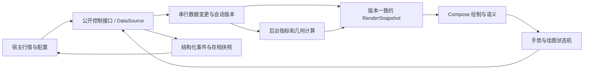

# PRD：KLineChart 原生 Kotlin / Jetpack Compose 图表库

| 项目 | 内容 |
|---|---|
| 文档版本 | 0.1，需求与实施规划稿 |
| 日期 | 2026-10-25 |
| 项目暂定名 | LKanvas；最终名称及 Maven groupId 在 M0 确定 |
| 已确认平台 | **Android + Jetpack Compose 首发**；用户已确认 |
| 上游功能基线 | KLineChart v10.1.0，提交 `d5bb26f706a6bd8f67eed4ecbbf22cb67a0725df` |
| 交付性质 | 独立维护、独立发布的原生库；源码与行为参考上游，非逐文件机械翻译 |
| 本文交付范围 | 产品需求、兼容边界、验收标准、风险、任务与里程碑；不表示 SDK 已实现 |
| 使用者 | 产品负责人、Android/算法开发者、测试、SDK 接入方与维护者 |

> 本文“必须”是相应交付阶段的验收要求。“建议目标”是立项初值，在 M0/M2 基准验证后冻结；调整必须记录原因和影响，不允许在发布时临时降低标准掩盖问题。只有 Android 首发与纯 Kotlin/Compose 方向已由用户确认，设备、工期、性能数值和业务范围中的具体默认值均为本 PRD 的规划提案。

阅读路径：立项看第 1–3、9、11、13 节；开发按第 4–6、10 节拆任务；测试按第 7–8、14 节验收；长期维护看第 12、15 节。需求 R、内置指标 I、覆盖物 O、验收 A、任务 T 的编号相互关联，不能只按功能数量认定完成。

## 1. 背景、目标与成功定义

现有 KLineChart 提供较完整的指标、覆盖物、坐标轴与数据接入模型，但依赖浏览器 Canvas、DOM 和事件系统。项目希望保留这些功能与可扩展性，改用 Kotlin 领域计算及 Jetpack Compose 原生绘制，以稳定依赖形式供后续 Android 应用引入。

### 1.1 产品目标

1. 提供可复用的 Compose K 线组件，使业务应用通过公开接口接入行情、样式、指标和绘图，不复制内部源码。
2. 在明确的 Android 等价范围内移植上游核心功能，最终覆盖 **27 种指标、16 种覆盖物、7 种基础图形、6 种主图表现形式**。
3. 保证实时末根更新、历史分页、切品种、交互画线和恢复状态的正确性。
4. 在固定设备和负载上达到可复现的性能门槛，并证明增量路径确实减少工作量。
5. 建立上游变更追踪与选择性移植机制；使本地功能可以通过扩展接口维护。

### 1.2 纯 Kotlin / Compose 的定义

- 发布库的自有生产实现采用 Kotlin；核心计算不依赖 Android UI 类型。
- 图表布局、文字、绘制、输入和语义由 Compose 及 Android 平台能力实现；允许 Compose 底层使用平台 Canvas/Skia。
- **生产路径不包含 WebView、JS 引擎、JS 桥、DOM，也不通过截图/纹理转发网页图表。**
- Node/TypeScript 仅可在开发和 CI 中运行上游对照测试，不进入 AAR/JAR 或宿主运行时。
- 不要求重写 Android/Compose 自身的 Java 或原生依赖；“纯 Kotlin”约束的是自有实现与运行架构。
- 不是 Kotlin/Native 编译目标；Android 首发使用 Kotlin/JVM。iOS/Desktop 不属于此次交付承诺。

### 1.3 成功定义

| 成果 | 完成条件 |
|---|---|
| 可接入 | 独立示例应用只通过发布依赖及公开接口完成基础图表、实时更新和扩展 |
| 功能到位 | 对应阶段的需求、内置能力清单和验收用例全部通过；不能以 demo 截图代替验收 |
| 数值可信 | 固定 TS 对照 + 独立数值样例 + 增量/全量一致性通过 |
| 原生有效 | 无网页运行依赖；完成目标设备的帧、延迟、内存、生命周期测试 |
| 更新可控 | 完成一次真实上游补丁的评估、移植或“不适用”演练，留有证据 |
| 可维护 | 公开接口、存档格式、兼容清单、回归数据和来源映射有版本 |

“比 Web 更快”“120 Hz 稳定”“支持任意数量数据”不作为未经测试的宣传承诺。

## 2. 用户、使用场景与产品职责

### 2.1 使用者

- **应用开发者**：在行情详情页嵌入组件，接入已有行情服务，控制主题和状态。
- **扩展开发者**：增加指标、绘图工具、格式化规则或自定义坐标轴。
- **终端使用者**：浏览、缩放、定位行情，查看指标，绘制并保存分析标注。
- **库维护者**：定位错误、复现性能问题、跟踪上游修复并发布兼容版本。

### 2.2 必须支持的用户旅程

| 场景 | 预期体验 |
|---|---|
| 首次打开 | 显示加载状态；数据就绪后展示最新区域；空数据与失败有区别 |
| 实时查看 | 末根价格变化即时更新；新 candle 出现后按当前跟随模式滚动 |
| 浏览历史 | 向左拖动触发加载；加载前后原有 candle 不发生位置跳变 |
| 切品种/周期 | 新会话显示独立状态；旧网络/计算结果不混入 |
| 查看数值 | 十字线定位同一时间，各 pane 提供对应价格/指标值 |
| 添加指标 | 选择内置或自定义指标；参数修改、显示隐藏、移除即时生效 |
| 画线 | 创建、选中、移动端点/整体、锁定、删除；中断后状态可预测 |
| 离开与返回 | 宿主可恢复配置、视口和已完成绘图；不会因短暂空状态覆盖存档 |
| 无障碍访问 | 可读取选中 candle 和指标摘要，并使用替代动作移动选择、缩放和删除 |

### 2.3 职责边界

库负责图表数据契约、计算、绘制、交互、结构化状态和事件；宿主负责真实行情请求、认证、缓存/数据库、交易订单、云同步及业务导航。提供 DataSource 接口不代表库内置交易所 SDK。

首版不提供交易执行、账户、订单风控、逐笔成交聚合、复权计算、完整交易日历、Pine Script、KLineChart Pro UI。订单线可作为扩展示例，真实交易语义不进入图表核心。

## 3. 版本范围与兼容边界

### 3.1 交付阶段

| 阶段 | 定位 | 必须包含 | 不可宣称 |
|---|---|---|---|
| M0 | 基线与风险验证准备 | 能力映射、数值样例、设备/版本矩阵、验收口径 | 已完成移植 |
| M1 | 数据与坐标基础 | 数据变更、会话、视口、基础坐标和 JVM 测试 | 已有可用 UI 库 |
| M2 / Alpha | 完整纵向链路 | 实心 candle、VOL/MA/MACD、线性轴、缩放/拖动/十字线、segment、分页/实时、原生性能初测 | 上游全功能兼容 |
| M3 | 指标与图表补齐 | 全部 27 指标、6 主图类型、多轴、格式化与图例 | 全部覆盖物和恢复已完成 |
| M4 / Beta | 交互与状态补齐 | 全部 16 覆盖物、7 图形、自定义扩展、版本化存档及无障碍 | 已通过发布稳定性验收 |
| M5 | 稳定与性能验收 | 边界、竞态、压力、设备、内存、公开接口和数值回归 | 未经证据的性能比较结论 |
| M6 / 1.0 | 独立 SDK 发布 | 合格制品、独立接入样例、完整文档、同步演练和全部发布门槛 | DOM/JS 插件兼容或全部平台支持 |

Alpha 可以用于内部试验；默认生产接入门槛是 1.0。Beta 提前试用必须显式标明接口和存档稳定性状态。

### 3.2 兼容分层

- **必须对齐**：正常输入下的指标公式/参数/预热、几何含义、pane/axis/overlay 的领域行为，以及已经列入范围的功能。
- **原生等价**：创建/销毁、触摸、弹出操作、截图、格式化、样式和生命周期使用 Kotlin/Compose 方式表达。
- **不逐字兼容**：JS 方法名、动态对象结构、回调签名、DOM 节点、CSS、CanvasRenderingContext2D、自定义 JS 插件。
- **不要求逐像素相同**：不同字体与抗锯齿可以产生差异；数据位置、控制点、轴值和标签含义必须正确。
- **有意差异**：更严格的输入验证、已知缺陷修正和 Android 交互适配必须登记；不能默默修改行为后仍声称完全一致。

M0 将上游公开入口逐项登记到兼容清单，状态只能为“已映射待实现、已实现已验收、有意差异、平台不适用、明确延期”。1.0 不得存在未经解释的“未知”；本文 1.0 必需能力不能仅标延期后通过发布。

### 3.3 明确排除或后续版本

- iOS、Desktop、Web、Compose Multiplatform 正式支持：后续单独立项。
- 浏览器 hover/右键/快捷键原样复制：以 Android 触摸和可访问操作等价；外接键鼠增强为 P2。
- 多图联动管理器、回放交易、撤销/重做完整历史、云端存档、自动技术形态识别：P2；1.0 提供必要事件/状态，不能宣称功能已完整提供。
- 任意 JS 插件运行、自动 TS→Kotlin 同步器、多个渲染引擎可切换框架：不在范围。
- 120 Hz：可测增强目标；1.0 默认以 60 Hz 门槛验收。

## 4. 领域约定与总体结构

### 4.1 统一术语

| 术语 | 本项目中的准确含义 |
|---|---|
| Candle | 一个周期的 OHLCV/turnover 数据点；不是 Compose 节点 |
| MarketKey | 市场/品种/周期/复权或数据口径标识；用于隔离数据与存档 |
| Session | 一次加载上下文；即使 MarketKey 相同，重新加载也产生新 sessionId |
| Revision | 已接受的数据变更版本；区别于绘制帧号 |
| ReplaceLatest | 替换与末根时间戳相同的数据，不增加 candle 数量 |
| Append | 加入更新的 candle；不等于给旧 candle 再递推一次 |
| PrependHistory | 补充更早数据；保持用户看到的已有数据锚点 |
| PatchHistory | 显式纠正已存在历史值；区别于实时末根更新 |
| Pane / Axis | 独立绘图区 / 将数据值映射到位置的坐标轴 |
| IndicatorDefinition / Instance | 指标模板 / 携带参数、pane、axis 与独立状态的实例 |
| OverlayDefinition / Instance | 绘图模板 / 携带控制点、样式及交互状态的实例 |
| RenderSnapshot | 一帧可安全消费的数据、几何和结果集合；不能由后台线程同时改写 |
| Missing | 未预热、字段缺失或结果无定义；不是数值 0 |

### 4.2 模块规划

初始只发布两个模块：

| 模块 | 内容 | 禁止依赖 |
|---|---|---|
| `lkanvas-core`（暂名） | 数据变更、会话/版本、指标、视口/坐标、覆盖物领域状态、存档 DTO | Android Context、Compose State/Color/Offset、WebView、具体网络/数据库 |
| `lkanvas-compose`（暂名） | Composable、绘制/文字、手势、无障碍、Compose 生命周期、公开接入控制 | JS 运行时、应用业务仓库和交易服务 |

示例应用、基准应用、TS 对照工具是开发制品，不额外拆出通用运行框架。确有复用与依赖隔离需求时再拆模块。

实现可以调整内部类结构，但必须保持单一数据事实来源、可定位的坐标转换及可测试的接口。不照搬上游大 Store，也不为每个上游文件建立一个 Kotlin 对应类。

### 4.3 SDK 接口原则

公开能力限于图表创建/绑定、数据提交或 DataSource、指标与覆盖物操作、视口、主题/格式化、事件、快照恢复/导出。接口必须说明线程、顺序、错误、生命周期与耗时特征；本 PRD 的名称不是冻结的 Kotlin 签名。

宿主通过不可变配置和稳定控制对象接入；普通重组不能重新建图、重新订阅或重算全部指标。事件不能回写形成缩放/视口反馈死循环；提供来源标识或幂等处理。公开结果不泄露可任意修改的内部数组/插件运行对象。

## 5. 功能需求与验收边界

优先级定义：P0 为纵向链路和正确性基础，P1 为 1.0 必须补齐能力，P2 为明确延期。P0/P1 均不能在相应版本带未处理的阻断缺陷发布。

### R-01 数据模型与输入验证（P0，M1）

- 时间使用 `Long` 毫秒；OHLC、volume、turnover 使用 `Double`；可选字段缺失须可表达，不自动当成 0。
- OHLC 必须有限，满足 `low <= min(open,close) <= max(open,close) <= high`；允许负价格在线性/兼容轴上显示。已提供的 volume/turnover 默认要求有限且非负；特殊口径须经数据适配明确转换。
- 初始数据严格按时间递增，不接受重复时间戳；错误返回包含操作、索引和原因，整次提交不改变原状态。禁止静默排序来掩盖错误来源。
- 支持空列表、单根、全部同价、极小价格和大价格。价格精度是显示/最小变动约束，不通过 Float 存储 OHLC。
- API 不承诺 Double 无法表达的报价精度；声明数据范围与最小变动单位，在样例中验证相邻报价可区分。订单结算精度不属于图库职责。
- 验收：A-01、A-02；任务 T-03。

### R-02 数据变更与背压（P0/P1，M1、M3）

- 基础操作：Reset、ReplaceLatest、AppendBatch、PrependHistory；Beta 前补齐 PatchHistory。
- 实时 upsert 同时间戳替换末根，大于末根追加，小于末根返回明确错误，不能隐式改历史。
- 历史分页可包含边界重叠：完全相同的 candle 幂等去重；同时间戳内容不同返回冲突，宿主通过显式纠正操作处理。不得重复插入或偷偷保留未知一方。
- 变更串行提交；每次成功有 revision/结果回执。接收队列有界；满载背压或明确拒绝，不静默丢失 Append/Reset/Patch。
- 可以合并同 session、同末根的连续展示更新，但不能跨新增 candle 边界丢数据，也不能把原始成交 tick 当 candle 任意丢弃。
- 数据数量上限明确可配置；建议默认 100,000 根，超限明确拒绝或由宿主显式替换窗口，禁止自动删除历史和画线锚点。没有“无限历史”承诺。
- 验收：A-03、A-04、A-05、A-06；任务 T-04、T-15。

### R-03 会话、并发与计算提交（P0，M1/M2）

- 每次 Reset/切换 MarketKey 产生新 sessionId；指标任务绑定 sessionId、dataRevision、实例 ID 与配置版本。
- 旧请求/旧任务即使无法及时取消，结果也必须被丢弃；重试、样式变更或切回同品种不能使旧结果重新有效。
- 结果提交在受控串行上下文发生；计算线程不能直接修改 Compose 可观察状态。
- RenderSnapshot 不得显示属于另一会话的任何值。指标未就绪必须标记 Pending/Missing；不得将旧末根结果无标识显示为当前值。慢自定义指标不能阻止其余已就绪内容更新。
- 主图与指标有明确版本对应关系；允许实现经过验证的未受影响前缀复用，不允许仅比较数据引用就假定结果仍有效。
- 验收：A-07、A-08、A-09；任务 T-05、T-09。

### R-04 历史数据加载与错误状态（P0，M2）

- 提供可由宿主实现的历史加载/实时订阅契约；也允许直接提交数据变更，二者不能同时成为同一图表的独立写入者。
- 支持初始、向前、向后分页，两个方向的 hasMore 独立管理；同方向同游标避免重复请求。
- 数据层只定义请求语义，不内置 REST/WebSocket 客户端。提供本地确定性 DataSource 示例。
- 初始加载、空数据、初始失败、分页失败、重试、实时断开必须可区分。分页失败保留已有图表和视口；取消不展示为业务错误。
- 离开图表/切会话时结束订阅；回来按宿主策略重连，不能重复订阅。后台展示降频不等于丢弃数据事实。
- 验收：A-10、A-11；任务 T-10。

### R-05 视口、横轴与坐标（P0/P1，M1/M3）

- 所有主图、指标、覆盖物和十字线共用坐标契约，明确 candle 中心、barSpacing、gap、content bounds 与 px/dp。
- 支持滑动、缩放、最小/最大 barSpacing、左右边界、右侧留白、定位时间/索引、回到最新、重置视口。
- 补历史时保存时间戳锚点及其像素位置；用户浏览历史时新行情不强制拉回末端。只有开启跟随且原来位于末端时自动跟随。
- 缩放锚点支持触点和末根；数据 index 只是临时定位，不能作为跨分页存档的唯一标识。
- 横轴默认按数据序列均匀排布，不自动补周末、休市或缺失 candle。未来留白可用逻辑位置；未来时间标签依赖宿主提供的周期/日历策略，未知时不伪造交易时间。
- 验收：A-12、A-13、A-14、A-15；任务 T-06、T-16。

### R-06 纵轴、多 pane 与布局（P0/P1，M1/M3）

- Alpha 支持主图+成交量+MACD 三个 pane 与线性轴；1.0 支持创建、移除、排序、调高低和折叠/恢复配置，最低高度避免绘图区为负。
- 支持每 pane 多轴、指标轴绑定、左右位置、轴反转、范围/刻度扩展，调整布局不会改变数据。
- 1.0 实现 normal、percentage、logarithm。特别注意基线上游 logarithm 是 `sign(v)*log10(1+abs(v))`，并非只允许正数的普通 log10；零/负数/小于 1 的值都要测试。
- percentage 正常情况下以首个可见 candle 的 close 为基准，与固定上游行为对照；基准为零时禁止 NaN/Infinity 和虚假涨幅，原生建议显示“—”并提供状态，登记为有意差异 D-01。实际像素范围需保持稳定。
- 全部同值、空结果和极端范围必须有有限的默认范围；自定义 tick 非单调、超量或不收敛须拒绝/降级并报告，禁止无限循环。
- 验收：A-16、A-17、A-18；任务 T-06、T-16、T-17。

### R-07 原生绘制、主图类型与样式（P0/P1，M2/M3）

- 完成六种主图：`candle_solid`、`candle_stroke`、`candle_up_stroke`、`candle_down_stroke`、`ohlc`、`area`。
- 支持涨跌/平颜色、按开盘或昨收比较、动态颜色、实体/边框/影线、网格、最后价格、可见最高最低标记、面积线/填充及指示点。
- 只绘制可见区间及必要边缘；大数据不创建逐 candle 的 Composable 节点。数据与轴计算用 Double，归一化到屏幕后才转换绘制 Float。
- 主题、线宽、虚线、文字、间距、裁剪、图层顺序通过类型化配置暴露；内置明暗主题，不强制宿主依赖某套 Material 主题。
- 样式回调必须可定位错误且有执行约束；颜色变化不触发数值指标重算。
- 验收：A-19、A-20、A-21；任务 T-07、T-18。

### R-08 指标计算与扩展（P0/P1，M2/M3）

- 支持指标模板注册、实例 ID、同名不同参数实例、主副图放置、轴绑定、参数覆盖、显示隐藏和移除；实例不得共享可变计算状态。
- 指标输出区分有效值与 Missing；预热、除零、字段缺失和无定义结果不得自动画成 0，也不能输出 Infinity。
- 上游部分指标会将缺失字段默认为 0；原生对“该公式必需字段缺失”采用 Missing/状态说明，登记为有意差异 D-03。输入本来就是有效数值 0 时仍按公式处理，两者不得混淆。
- 默认每次已接受的 candle 更新都推进结果；没有默认“仅收盘更新”来规避性能验收。
- 支持全量计算与可选增量计算。Alpha 的 MA/VOL/MACD 必须实现正确增量；1.0 所有模板都必须有正确全量路径，是否增量在能力清单记录，不承诺所有自定义算法 O(1)。
- EMA/MACD 等递推指标替换末根时从上一根已确定状态重新求值；追加后才推进基状态。Prepend/Patch 对递推指标可影响整个后缀，不能仅更新改动位置。
- 参数变化使缓存失效。缓存键包含会话、数据版本、定义/实例与参数版本；相同对象引用不能证明数据未变。
- 每种指标冻结公式、输出 key、参数、种子、预热、缺失和精度规则；SMA 名称不能直接按另一个市场的常见公式替换。AVP 不自动等同于按交易日重置的 VWAP。
- 自定义计算报错后保留图表可操作，问题实例显示 Error，可移除/修改后恢复；不得捕获严重系统错误伪装成功。
- 验收：A-22、A-23、A-24、A-25、A-26；任务 T-09、T-11、T-12、T-13、T-14。

### R-09 基础图形与覆盖物框架（P0/P1，M2/M4）

- 实现 circle、line、polygon、rect、text、arc、path 及其必要命中能力；path 定义为受控 Kotlin 路径指令，不要求嵌入 JS/SVG 运行环境。
- 覆盖物具有稳定 ID、模板名/版本、pane/axis、控制点、样式、锁定/可见、层级、扩展数据。
- 状态至少覆盖 Idle、Creating、Selected、Dragging、Completed、Cancelled/Removed；每次开始/完成/取消事件恰好一次。
- 支持 normal/weak_magnet/strong_magnet；磁吸基准和作用范围按兼容清单约定。命中层级与绘制一致（单一 z 序遍历，第六轮复审 M06 口径）：同实例内控制点优先于线身、跨实例按层级竞争（z 序，上游 Eventful 逆序分发模型）；未命中任何对象回落图表拖动。
- 绘图点用数据/时间锚点保存；补历史、缩放、旋转与 pane 改尺寸后仍锚定原数据。未来点采用显式逻辑锚点及参照，不持久化裸数组 index。
- 锁定禁止编辑但允许检查/选择；删除必须由明确操作触发。单条异常绘图不破坏其他图形。
- Alpha 完成 segment；Beta 完成全部 16 种。斐波那契在非线性轴上按价格计算层级再投影，避免标签数值与线位置不一致；与上游屏幕插值差异登记为 D-02。
- 验收：A-27、A-28、A-29、A-30；任务 T-19、T-20、T-21、T-22。

### R-10 Android 手势与输入竞争（P0/P1，M2/M4）

- 单指拖动、双指缩放、惯性、长按十字线、点击 candle、轴拖动缩放、pane 分隔条调整有明确状态机。
- 使用系统触摸阈值，不能只靠位移为零判断点击；第二指加入、取消事件、失焦、离开组合、数据重置必须结束或取消当前交互。
- 图表未启用绘图时，普通滑动优先平移；启用绘图时按工具模式处理。外层纵向滚动/Pager 的竞争有公开策略与示例，禁止无条件消费全部事件。
- 不照搬浏览器右键删除；提供事件及可访问操作供宿主展示原生菜单。
- 手势可在 60 Hz 连续输入下运行，不能在 pointer 回调中同步全量计算指标或持久化。
- 验收：A-31、A-32、A-33；任务 T-08、T-23。

### R-11 十字线、图例、格式化与本地化（P0/P1，M2/M3）

- 十字线在所有 pane 对齐相同数据时间；当前 pane 使用自己的轴展示 y 值。空数据/预热指标显示“—”。
- 支持常显、跟随十字线、隐藏的图例/tooltip；支持固定和跟随触点布局，避免遮挡触点及越界。可通过 Compose slot 或事件实现宿主定制。
- 提供时区、日期/价格/成交量格式化、千分位、小数折叠和中英文资源扩展；UTC 存储不随显示时区改变。
- 价格与成交量分别精度；实时渲染不创建无界 formatter/cache。DST、跨日、跨月、非英文长文本要有样例。
- 工具按钮/图例操作通过语义事件公开；不要求复用上游 icon-font 或浏览器图标资源。
- 验收：A-34、A-35；任务 T-18、T-24。

### R-12 存档、恢复与生命周期（P1，M4）

- 提供版本化 DTO/序列化协议，包含 MarketKey、schemaVersion、模板版本、指标参数、已完成绘图、主题引用与视口锚点。不序列化协程、回调、Context 或整个运行对象。
- 库提供 export/restore，不强制磁盘或网络存储。建议上限 1 MiB/快照和 500 个覆盖物，超限显式错误；大历史数据不进入 Bundle/SavedState。
- 宿主控制恢复时机；恢复完成前不得把自动创建的空列表作为已保存状态发出。恢复失败返回原始错误和未知条目，不能自动覆盖或删除原存档。
- 不同品种默认隔离；跨周期共享画线不是默认行为。缺失模板保留原始条目用于再次恢复；已知字段损坏默认整次失败，部分恢复必须由宿主显式选择。
- Compose 重组不重置状态；离开后取消订阅、任务、动画和监听。配置变更/进程重建通过小状态与宿主数据重载恢复，不假设内存实例永存。
- 验收：A-36、A-37、A-38、A-39；任务 T-25、T-26。

### R-13 无障碍与自适应（P0/P1，M2/M4）

- Canvas 内容必须配套语义：图表摘要、当前时间/OHLCV/指标值、可访问的前后选择与缩放动作；不为全部历史 candle 创建语义节点。
- 涨跌不能只依赖颜色；当前选择有文本/形态辅助。工具操作触达区域按 Android 可访问设计，绘图细线通过扩大的命中区域或替代列表操作提供访问。
- TalkBack 可检查数据、切选择、选择/删除覆盖物；绘制提供替代输入/控制点操作示例，不以多指手势作为唯一入口。
- 字体缩放 1.0/1.3/2.0、横竖屏、窄屏和分屏不得崩溃或使关键操作不可达；可降级为摘要布局，不要求所有标签同时显示。
- 验收：A-40、A-41；任务 T-24、T-27。

### R-14 扩展、隔离与事件（P1，M4）

- 支持自定义 Indicator、Overlay、Figure、Axis、Formatter；使用实例级或显式共享注册表，禁止隐式跨图污染。
- 模板重名返回冲突，替换需显式指定；示例使用命名空间，避免与上游新增模板碰撞。
- 事件至少覆盖可见范围、缩放/滚动、十字线、candle 点击、pane 调整、指标状态、覆盖物创建/修改/删除、数据/加载错误。终态事件可靠且顺序明确，高频移动事件允许合并。
- 慢插件和异常插件有可诊断标识；同步 draw 回调无法被安全强制抢占，必须公开“不得阻塞/IO”的契约并提供耗时诊断，不承诺隔离任意恶意代码。
- 验收：A-26、A-42；任务 T-28。

### R-15 图片导出与诊断（P1，M5）

- 导出当前图表内容为 PNG/Bitmap，由宿主决定存储或分享；无数据时输出定义明确，不要求包含宿主工具栏。
- 可选择包含十字线/交互层；导出固定使用同一快照，不能出现不同 revision 拼接。指定输出尺寸受内存上限约束，默认限制 4096×4096，超限返回错误。
- 提供关闭默认日志的诊断入口：数据/结果版本、可见范围、计算耗时、绘制耗时、缓存与插件状态；不记录认证信息，不把宿主行情上传外部服务。
- 验收：A-43、A-44；任务 T-29、T-30。

### R-16 SDK 分发、兼容与文档（P0/P1，M0/M6）

- 发布 core JAR 与 compose AAR、源码包和 API 文档；自身命名与版本号独立于 KLineChart。
- Android 最低版本规划值为 API 23，Kotlin/Compose/AGP/JDK 组合在 M0 实际编译验证后冻结；如依赖要求更高，在 M0 明确调整，不在 1.0 前临时抬高。
- 至少验证最低 API、一个中间 API、冻结时最新稳定 API；依赖兼容至少覆盖选定 Compose 基线和一个相邻受支持版本。
- 不要求宿主打开 INTERNET 权限才能使用本地数据；无网络可展示、计算、交互与导出。
- 独立 consumer 项目从本地/测试 Maven 仓库加载制品，不能 project dependency 偷用 internal 接口；验证 R8 release。
- 文档包含十分钟接入流程、数据契约、生命周期、全部内置能力、扩展示例、性能范围、存档迁移和来源说明。发布制品保留适用 LICENSE/NOTICE。
- 验收：A-45、A-46、A-47；任务 T-01、T-02、T-31、T-32。

### R-17 上游追踪与兼容维护（P1，M0/M6）

- 固定 release+SHA，维护源文件→Kotlin 能力/测试映射。上游 main 不直接作为生产依赖或可变对照。
- 变更分为数值/数据正确性、交互、性能、新功能、浏览器专属、破坏性变更；分别决定移植、延期、不适用。
- 每次采用的补丁带原提交、影响能力、Kotlin 改动和回归用例。文档、源码与实测冲突时保留记录，不能只依据迁移指南。
- 选择性同步是维护流程，不承诺自动 merge。SDK、兼容基线、存档 schema 分别版本管理。
- 验收：A-48；任务 T-01、T-33。

### R-18 性能与稳定性（P0/P1，M2/M5）

- 以第 7 节固定负载与计量方法为准，不能用平均 FPS 或桌面模拟器替代。
- UI 线程无全量指标计算、磁盘 IO 或无界历史复制；主要回调和渲染路径必须可测。
- 必须测试首次加载、末根更新、追加、分页、缩放、画线、切品种和循环创建销毁。
- 发现性能瓶颈优先修复实际工作量、分配与重绘范围；不得通过隐藏必需指标或改成只收盘更新获得通过。
- 验收：A-49、A-50、A-51；任务 T-30、T-34、T-35。

## 6. 内置能力逐项移植清单

以下名称和默认参数以固定上游源码为基准；参数只是起点，每项都需建立公式说明与可执行样例。正式实现时不允许“按名称找另一份公式”代替对照。

### 6.1 全部 27 种指标

| 编号 | 指标 | 默认参数 | 首次完整交付 | 特别验收点 | 任务 |
|---|---|---|---|---|---|
| I-01 | MA | 5,10,30,60 | Alpha | 多周期预热、末根替换、窗口边界 | T-11 |
| I-02 | VOL | 5,10,20 | Alpha | volume 缺失与零、颜色、均量线 | T-11 |
| I-03 | MACD | 12,26,9 | Alpha | EMA 种子、DIF/DEA/柱倍率、连续替换 | T-11 |
| I-04 | EMA | 6,12,20 | M3 | 初始种子、追加与替换、历史纠正 | T-12 |
| I-05 | SMA | 12,2 | M3 | 上游递推公式与命名歧义、参数有效性 | T-12 |
| I-06 | BOLL | 20,2 | M3 | 方差分母、平盘、大数小波动稳定性 | T-12 |
| I-07 | BBI | 3,6,12,24 | M3 | 参数个数改变、分母与预热 | T-12 |
| I-08 | BIAS | 6,12,24 | M3 | MA 为零、多个输出预热 | T-12 |
| I-09 | AO | 5,34 | M3 | 中间价及两窗口边界 | T-12 |
| I-10 | MTM | 12,6 | M3 | 回看索引与平滑预热 | T-12 |
| I-11 | ROC | 12,6 | M3 | 回看值为零、样本不足 | T-12 |
| I-12 | PSY | 12,6 | M3 | 平价是否计入、窗口分母 | T-12 |
| I-13 | KDJ | 9,3,3 | M3 | 窗口高低相同、K/D 种子、J 范围 | T-13 |
| I-14 | RSI | 6,12,24 | M3 | 连涨、连跌、平盘、零损失分母 | T-13 |
| I-15 | WR | 6,10,14 | M3 | 高低相同、正负号与取值域 | T-13 |
| I-16 | CCI | 20 | M3 | 平均偏差为零、浮点消减 | T-13 |
| I-17 | DMI | 14,6 | M3 | TR、DM 平局规则与多输出预热 | T-13 |
| I-18 | BRAR | 26 | M3 | 昨收引用、上下分母为零 | T-13 |
| I-19 | CR | 26,10,20,40,60 | M3 | 累积窗口、偏移和平滑、历史修正 | T-13 |
| I-20 | VR | 26,6 | M3 | 平价成交量分配、零量 | T-13 |
| I-21 | EMV | 14,9 | M3 | 所需字段、零分母、单位 | T-13 |
| I-22 | SAR | 2,2,20 | M3 | 趋势反转、加速因子、极值状态回退 | T-14 |
| I-23 | TRIX | 12,9 | M3 | 多级递推、预热和零基值 | T-14 |
| I-24 | OBV | 30 | M3 | 平价处理、累计量与均线 | T-14 |
| I-25 | PVT | 无 | M3 | 首根、昨收为零、累计误差 | T-14 |
| I-26 | AVP | 无 | M3 | turnover/volume 缺失、累计零量；不擅自按日重置 | T-14 |
| I-27 | DMA | 10,50,10 | M3 | 双均线差、后续平均与预热 | T-14 |

每项交付必须包括：参数校验、至少一个手算样例、固定 TS 对照、有效值位置对照、随机/边界数据、增量或明确全量声明、图例与样式、修改/删除/恢复实例测试。只通过最终一个数值的比较不算完成。

### 6.2 全部 16 种覆盖物

| 编号 | 上游名称 | 交付 | 关键验收 | 任务 |
|---|---|---|---|---|
| O-01 | segment | Alpha | 两点、拖端点/整体、取消、命中 | T-19 |
| O-02 | straightLine | Beta | 双向延伸、竖线退化、裁剪 | T-20 |
| O-03 | rayLine | Beta | 单向延伸、方向反转 | T-20 |
| O-04 | horizontalRayLine | Beta | 水平约束和射线方向 | T-20 |
| O-05 | horizontalSegment | Beta | 两端水平约束 | T-20 |
| O-06 | horizontalStraightLine | Beta | 全宽水平、轴值同步 | T-20 |
| O-07 | verticalRayLine | Beta | 垂直约束和射线方向 | T-20 |
| O-08 | verticalSegment | Beta | 两端垂直约束 | T-20 |
| O-09 | verticalStraightLine | Beta | 时间锚点、全高显示 | T-20 |
| O-10 | parallelStraightLine | Beta | 第三点、平行关系、退化输入 | T-21 |
| O-11 | priceChannelLine | Beta | 通道宽度、整体移动、轴切换 | T-21 |
| O-12 | fibonacciLine | Beta | 默认比例、反向取点、非线性轴值/位置一致 | T-21 |
| O-13 | priceLine | Beta | 价格/标签、精度与选中 | T-22 |
| O-14 | simpleAnnotation | Beta | 文字边界、时间锚点、字体缩放 | T-22 |
| O-15 | simpleTag | Beta | 标签布局、裁剪、命中区域 | T-22 |
| O-16 | brush | Beta | 连续采样、缩放后保持、取消、点数限额 | T-22 |

所有覆盖物执行共用生命周期、锁定、层级、磁吸适用性、保存/恢复与多实例隔离测试。brush 建议每条上限 5,000 个点，超过时明确终止采样并报告，不无界增长；若采用简化算法，必须规定屏幕误差并测试缩放后的形状。1.0 不承诺撤销整个编辑历史。

### 6.3 其他能力

| 清单 | 交付 |
|---|---|
| 基础图形 circle / line / polygon / rect / text / arc / path | Alpha 提供 segment 必需的 line/point/text；Beta 全部完成，由 T-19、T-22 承担 |
| 主图 candle_solid / candle_stroke / candle_up_stroke / candle_down_stroke / ohlc / area | Alpha 第一项；M3 其余五项，T-07、T-18 |
| 轴 normal / percentage / logarithm + 自定义轴 | Alpha normal；M3 其余及扩展，T-06、T-16、T-17 |
| 图例/tooltip/价格标记/主题/中英文/格式化 | Alpha 基础摘要；M3 完整范围，T-18、T-24 |
| PNG、运行诊断、独立制品、兼容清单 | M5/M6，T-29 至 T-33 |

## 7. 性能与稳定性验收方案

### 7.1 设备与测试条件

M0 必须登记真实可用的设备型号、SoC、RAM、分辨率、Android 版本、刷新率及温控条件。下列设备档位是规划值，不意味着任意同 RAM 设备性能等价：

- D1：中端参考机，6 GB 或以上 RAM，约 1080p，Android 12+，固定 60 Hz。
- D2：低端边界机，4 GB RAM，Android 10+，固定 60 Hz；另以最低 API 设备/模拟器验证功能兼容，不用模拟器代替性能数据。
- D3：支持 120 Hz 的参考机，作为增强测试，不阻断默认 60 Hz 版本。

设备型号在 M0 冻结后成为验收基准，不能在测试失败后换更快设备而不记录范围变化。Release/R8 构建、固定字体/密度/主题、关闭调试器，测量同样的编译状态；记录温度及电量。数据预先在内存中，网络不计入图库时间。

### 7.2 固定负载

| 场景 | 数据与配置 | 操作 | 作用 |
|---|---|---|---|
| B-01 基准 | 10k candle，约 300 可见；主图 MA+VOL+MACD 三 pane | 每秒 20 次末根更新；测试时间中每秒追加 1 根（加速行情）；连续拖动/缩放 | Alpha 与发布基本门槛；Alpha 1 条 segment，Beta 后另测 20 条覆盖物 |
| B-02 扩展 | 50k；6 pane、10 个不同指标实例、100 个覆盖物 | 20 次/秒更新、分页与画线编辑 | 1.0 压力门槛；发布前固定实例/工具清单 |
| B-03 容量 | 100k；3 pane 与 Alpha 指标组合 | 冷加载、定位、末根更新、追加和批量纠正 | 验证容量声明及完整计算时间 |
| B-04 突发 | 10k 起点，1 秒内提交 1,000 个混合替换/追加操作 | 停止输入后观察队列收敛及最终结果 | 验证背压/合并，不要求绘制中间每一状态 |
| B-05 生命周期 | B-01 配置，反复创建/销毁 30 次、切品种 100 次 | 包含恢复、取消与后台往返 | 泄漏、旧结果污染和重复订阅 |
| B-06 持续运行 | 有界数据集及固定覆盖物数量，30 分钟 | 更新、间歇手势、显式重载 | 热稳定性与缓存/队列增长 |

随机数据采用固定种子，保留操作日志与测试资源 hash。不能用不同指标参数、更新策略或可见 candle 数进行直接性能比较。

### 7.3 建议初始门槛

以下是待 M2 实测校准的**目标值**，不是已经获得的性能。M2 退出必须形成冻结版本；任何不能满足的目标需要范围/算法/设备调整记录，不能默认为“跳过”。

| 指标 | D1 目标 | D2 目标 | 计量定义 |
|---|---|---|---|
| B-01 热进程首个完整图表帧 P95 | ≤500 ms | ≤900 ms | 已挂载图表接受内存数据至主图和必需指标首帧呈现 |
| 固定样例 App 冷进程到完整图表 P95 | ≤1,500 ms | ≤2,500 ms | 包含进程/Compose 初始化，不含网络；作为样例指标，非任意宿主承诺 |
| B-01 frameDurationCpuMs P95 | ≤10 ms | ≤14 ms | Macrobenchmark；不是 GPU 总帧耗时 |
| B-01 超帧截止时间比例 | ≤1% | ≤3% | 可取得时用 frameOverrunMs>0 的帧比例；旧系统使用冻结的等价方法，不混算 |
| B-01 输入到视觉反馈 P95 | ≤50 ms | ≤100 ms | 输入时间至对应帧实际呈现，用 trace/FrameTimeline；不是事件回调返回时间 |
| B-01 内置增量计算 P95 | ≤4 ms | ≤8 ms | MA/VOL/MACD 总后台计算，不含被背压等待时间 |
| B-03 初始主图及必需指标就绪 P95 | ≤2,000 ms | ≤4,000 ms | 单独记录计算与绘制分项；期间 UI 可响应 |
| B-02 持续交互 | 超时帧≤5%，输入 P95≤100 ms | 报告实测并定义支持范围 | D1 必需压力门槛，D2 不承诺该组合流畅 |
| B-04 突发后收敛 | ≤2 s | ≤4 s | 从最后一个已接受操作到最终一致快照；最终数据/数值必须精确对上 |
| B-01 / B-03 图库增量 PSS | ≤60 / 150 MiB | ≤60 / 150 MiB | 相同热空白 Compose 样例作对照，分离数据/缓存/图形开销 |
| B-05 释放 | 0 个确定泄漏的图表/订阅/任务；稳定后 retained heap 增长≤5 MiB | 同左 | 排除已记录的一次性缓存后比较；结合对象引用检查，不只看总 PSS |
| B-06 | 无崩溃/ANR、队列/缓存无持续无界增长 | 同左 | 报告热态后半程指标，不能只测冷机前几秒 |

帧场景至少运行 5 轮、每轮 30 秒并预热，启动至少 20 次；保存全部结果及分位数。温控异常轮次可以重测但必须保留记录，禁止挑最好一次。针对绘制缺帧还需结合实际输入到帧呈现，不能仅靠“只绘制很少帧”获得低超时率。

### 7.4 工作量门槛

- B-01 末根替换不能遍历全部历史计算 MA/VOL/MACD；计数探针或 trace 证明工作量主要随参数/输出数量变化。
- 十字线移动不触发指标重算；主题变化不触发数据重算；不为每根 candle 重组节点。
- 视口裁剪前后渲染结果一致；缓存失效有正确性测试，不能以过期结果换速度。
- 若宣称比上游快，额外使用同设备、本地 WebView、固定上游版本及完全相同功能负载对比，单独披露原生与 WebView 的初始化/内存口径。没有比较不阻断 1.0，但禁止发布比较结论。

## 8. 测试数据、对照方法与验收用例

### 8.1 三层验证

1. **独立正确性**：手算/独立推导的固定样例验证公式、种子、边界，防止复制上游错误。
2. **上游行为对照**：相同数据和参数运行固定 TS 与 Kotlin，比较各时间位置的结果与有效掩码；浏览器相关行为使用可重复操作记录对照，不复制 DOM 实现。
3. **原生设备验收**：手势、文字、无障碍、生命周期与性能必须在 Android 环境验证。

全量与增量互相对照用于检测缓存/递推错误，但两者共享错误公式时仍可能同时通过，因此不能替代第一层。

### 8.2 必备数据集

| 数据集 | 内容 |
|---|---|
| F-01 | 空、1 根、窗口前后各 1 根、参数长度变化 |
| F-02 | 全部同价、零成交量、close=0、负价、正负跨零 |
| F-03 | 单调涨跌、尖峰/跳空、反转、相等高低和开收 |
| F-04 | 固定随机种子的 1k/10k/50k/100k 合法 OHLCV |
| F-05 | 大价格+小波动、极小价格、可表达的最小报价差 |
| F-06 | 缺失 volume/turnover、NaN/Infinity、重复/逆序时间、非法 OHLC |
| F-07 | DST、跨月/跨年、周末缺口、不连续交易时间、不同显示时区 |
| F-08 | 不同市场会话交错返回、网络失败、计算延迟、取消后回调 |
| F-09 | 连续末根更新、跨边界追加、prepend、历史纠正和参数更改组合 |
| F-10 | 多模板、多实例、损坏/旧版本/未知模板/超大存档 |
| F-11 | 线段重合、零长度、近垂直、跨轴/跨 pane、未来控制点、长 brush |
| F-12 | 不同密度、字体缩放、明暗主题、TalkBack 和触摸取消记录 |

数值比较先验证时间对齐、输出 key、预热与 Missing，再比较有效值。建议默认误差 `abs(a-b) <= 1e-9 + 1e-10*max(abs(a),abs(b))`；价格型结果在提供 tickSize 时还必须小于其 1/10。若数据精度本身不可表达，显式限定能力，不能放宽到掩盖报价差。个别公式需独立误差预算时，记录依据及上限，不统一四舍五入后比较。

二维数据↔像素往返的屏幕误差目标≤0.5 px；触点/端点最终呈现允许≤1 px 的对齐误差。截图同设备固定字体建立原生基线；与 Web 对照时比较几何与语义区域，不要求字体逐像素一致。

### 8.3 核心验收目录

以下目录是最低测试集合，每个测试需关联实现提交、测试方式和结果附件。手工测试也必须有操作步骤及实际记录。

| ID | 操作与预期 |
|---|---|
| A-01 | 对初始数据提交重复、逆序、非有限或非法 OHLC：返回定位错误，原数据与 revision 不变 |
| A-02 | 空/单根/同价/负价/大价小差：不崩溃；数值不先转 Float；合理范围内可区分报价 |
| A-03 | 同 timestamp 连续替换 1,000 次：长度不变；最终值与一次替换一致 |
| A-04 | 替换、批量追加、Reset 混合：顺序与回执一致；无重复、漏 candle 或跨 Reset 污染 |
| A-05 | 分页边界完全重复幂等；重复内容冲突可见；100k 超限有明确返回且不静默裁剪 |
| A-06 | PatchHistory 修改最早/中间/末根：所有受影响指标与从头全量计算一致 |
| A-07 | A 品种请求晚于 B 返回：最终始终为 B；切回 A 也不接纳旧 session 的结果 |
| A-08 | 参数变化和计算延迟交错：旧配置结果被拒绝；不存在旧数值冒充当前值 |
| A-09 | 计算中 Reset 为空，再重试/改主题：不得复用旧指标结果；后台无 Snapshot 写冲突 |
| A-10 | 初始空、失败、分页失败、重试、断流状态分别可观察；分页失败不清空已有图 |
| A-11 | 双向分页同时接近边界：单游标不重复加载；一方向 exhausted 不影响另一方向；释放无重复订阅 |
| A-12 | 随机位置数据↔像素往返：误差在预算内，主图/十字线/画线 candle 中心一致 |
| A-13 | 前插 1,000 根：同一锚点像素偏移≤1 px；新行情不会把历史浏览强拉到末端 |
| A-14 | 触点缩放、末根缩放、极限缩放、零尺寸再恢复：锚点规则稳定，无越界/无限循环 |
| A-15 | 周末/DST/未来留白：时间数据不被显示时区改写；未知未来时间不伪造成交易时间 |
| A-16 | 多 pane 多轴增删/排序/改高度：指标和覆盖物仍绑定原 ID；布局面积合法 |
| A-17 | signed-log 对负/零/小正值往返；percentage 零基准按 D-01 处理，无 NaN/Infinity |
| A-18 | 自定义轴返回重复/逆序/过多 tick：可诊断拒绝或降级，不挂死 UI |
| A-19 | 六主图类型、涨跌比较、颜色回调、网格/标记：样例与几何断言通过 |
| A-20 | 100k 中可见 300 根：渲染工作量依赖可见范围；小数价格转换无明显跳变 |
| A-21 | 换主题/字体/尺寸：缓存正确失效，无旧文本/裁剪错误；不触发指标计算 |
| A-22 | 27 指标逐输出验证参数、种子、预热、零分母、缺失字段及独立样例 |
| A-23 | EMA/MACD/SAR 等同根多次替换后追加：与最终全量结果一致，无重复递推 |
| A-24 | 至少 5,000 步固定随机变更序列：每个已检查 revision 的增量与全量结果一致；失败输出最小复现日志 |
| A-25 | 两个同名不同参数实例：更新/删除一个不影响另一个；参数改回后正确重算 |
| A-26 | 抛错/慢计算插件：错误可定位，其他内容继续可用；删除后不再接收结果 |
| A-27 | 16 覆盖物逐一创建/选中/移动/锁定/隐藏/删除；事件次数与顺序符合契约 |
| A-28 | 画线补历史、切轴/密度/方向后锚点不漂移；强弱磁吸与 candle 中心一致 |
| A-29 | 零长度线、重合点、垂直线、非线性轴斐波那契：有限几何；标签与实际线值一致 |
| A-30 | brush 达点数上限和持续取消：有界资源、明确事件、无残留 Creating 状态 |
| A-31 | 拖动→双指→取消→重新操作：无卡死、跳变、重复 click/complete |
| A-32 | 外层 LazyColumn/Pager 与图表组合：按策略分配手势；未参与手势不被无条件吞掉 |
| A-33 | 轴拖动、pane 调整、绘图编辑竞争：只存在一个明确操作所有者 |
| A-34 | 同时刻跨 pane 十字线和 tooltip 数值一致；Missing 显示“—”；固定/跟随布局不越界 |
| A-35 | 时区/语言/千分位/小数折叠变化：只影响显示；跨日/DST/长字符串验证通过 |
| A-36 | 导出→重建→恢复：已完成绘图/指标/视口语义等价；不含回调或整段行情 |
| A-37 | 异步恢复期间创建空图：不会触发覆盖原存档的保存事件；恢复失败原文档保留 |
| A-38 | 未知模板、旧 schema、损坏或超限快照：按策略处理，不静默丢弃条目后覆盖 |
| A-39 | 重组/旋转/后台/退出 30 次：无重复任务；进程重建从宿主数据和小状态恢复 |
| A-40 | TalkBack 读取 OHLCV/指标并前后选择、缩放、删除覆盖物；不依赖视觉猜测 |
| A-41 | 字体 1.0/1.3/2.0、窄屏/分屏/横竖屏：关键动作可达，数值与文本无越界崩溃 |
| A-42 | 注册同名模板、多图实例、事件回写：冲突显式，实例隔离，不形成反馈循环 |
| A-43 | 导出不同尺寸、空数据、带/不带交互层：单 revision、内容完整；超限无 OOM |
| A-44 | 诊断关闭时无不必要日志/上传；开启可定位 session、revision 和慢插件 |
| A-45 | 发布制品的生产代码不调用 WebView/JS 引擎；TS 对照资源未打入包；离线全流程可用 |
| A-46 | 独立 consumer 从 Maven 制品接入，最低/中间/最新冻结 API 与 R8 release 通过 |
| A-47 | 公开接口变更检测、文档示例编译、许可证/来源清单/版本声明通过 |
| A-48 | 选一个真实上游补丁完成分类、行为复现、移植或不适用说明及回归记录 |
| A-49 | B-01/B-02/B-03 满足冻结的帧、延迟、首图和内存标准，原始数据可重跑 |
| A-50 | B-04 突发接受/拒绝统计准确，期限内收敛；最终状态与串行参考一致 |
| A-51 | B-05/B-06 无确定泄漏、旧结果污染、无界缓存或队列，热态性能有记录 |

### 8.4 缺陷级别与通过原则

- S0：数据丢失/跨品种污染、确定数值错误影响主要输出、可复现崩溃/ANR、存档覆盖。相关阶段阻断。
- S1：范围内主要功能不可用、手势卡死、确定泄漏、设备门槛未达、指标/画线位置错误。发布阻断。
- S2：不改变数据含义的局部视觉或文档问题；必须有已知问题、影响和修复计划，不能涉及核心无障碍操作不可达。
- 所有阶段必需用例通过；不允许以总体通过率掩盖一项关键失败。无“自动略过失败”测试；不稳定测试要修复或提供等价可靠证据。

## 9. 重点难点与风险预案

| 风险 | 早期信号/后果 | 提前措施 | 负责任务/阻断点 |
|---|---|---|---|
| 机械翻译浏览器结构 | Kotlin 代码仍模拟 DOM，手势/布局难调整 | 先建立原生纵向链路，仅映射领域行为 | T-01、T-07；M2 |
| 末根递推错误 | 高频更新结果与刷新后不同 | 保存上一确定状态，全量/增量对照 | T-09、T-11、T-14；Alpha |
| 过期结果覆盖 | 快切品种/改参数出现旧线 | session+revision+配置版本，取消之外再次校验 | T-05；Alpha |
| 分页和画线漂移 | 左侧补数据后控制点偏移 | 时间锚点、统一 candle 中心、像素往返测试 | T-06、T-19；Alpha/Beta |
| 全量复制抵消增量 | 算法快但 GC/帧耗时仍随 N 增长 | 观察分配、快照所有权，避免每 tick 深拷贝全部历史 | T-09、T-30、T-34；M2/M5 |
| 公式名称与口径不一致 | SMA/RSI/SAR 在不同终端不同 | 公式/种子/有效区间冻结，独立样例，差异登记 | T-01、T-12 至 T-14；M3 |
| 对数/百分比语义误判 | 零/负价、基准零出现无穷/错轴 | 明确 signed-log；D-01；边界和往返样例 | T-16、T-17；M3 |
| 非线性几何与标签不一致 | 斐波那契文字值不在线所在价格 | 先算数据值再投影，登记 D-02 | T-21；Beta |
| 手势竞争及取消漏处理 | 画线后无法滚动、父容器吞事件 | 状态机、所有者、完整取消轨迹 | T-08、T-23；Alpha/Beta |
| 恢复前空状态覆盖 | 已保存画线下次打开消失 | 恢复事务与宿主保存时机，失败不写回 | T-25、T-26；Beta |
| Double/Float 与文字布局 | 高价小 tick 粘连、DPR 偏移、字体放大截断 | 数值到屏幕最后一步转 Float，密度/字体矩阵 | T-03、T-06、T-24；M3 |
| 插件造成阻塞 | 一个 draw/formatter 拖慢全图 | 公开线程/耗时契约、诊断、异常隔离；不承诺抢占任意代码 | T-28、T-30；M5 |
| 无障碍晚补 | Canvas 全图无语义/控件无法操作 | Alpha 即提供摘要与动作，Beta 完成绘图替代入口 | T-24、T-27；Beta |
| 文档与源码漂移 | 按迁移文档实现的接口与真实结果不同 | 固定 SHA、执行对照优先、留文档冲突记录 | T-01、T-33；M0/M6 |
| 大版本破坏扩展/存档 | 升级后模板字段丢失 | 独立版本、schema 迁移、未知条目保留 | T-25、T-32；1.0 |
| 首发范围无限扩大 | 同时承诺跨平台、订单系统和全部键鼠 | 以 R/I/O 清单与 P2 为准，变更重新估算 | 项目负责人；各里程碑 |
| 来源与分发遗漏 | 改语言后删除 NOTICE、缺第三方声明 | 从 M0 建来源清单，制品检查 | T-01、T-32；1.0 |

风险不能只写在报告里；每次里程碑评审需更新“已验证、仍存在、已接受差异、触发范围调整”及证据。

## 10. 工作分解与依赖

角色：C=核心/算法工程师，U=Compose/交互工程师，Q=测试/性能负责人，L=技术负责人。可以一人兼任，但代码作者不能仅凭自测宣布高风险数值/恢复行为通过。规模 S/M/L 仅表示相对复杂度，不代表承诺天数。

| 任务 | 阶段/角色/规模 | 前置 | 交付与验收 |
|---|---|---|---|
| T-01 固定基线与兼容台账 | M0，L/C，M | 无 | 来源、公开能力映射、TS 对照入口、差异 D-01/D-02/D-03；R-17、A-48 准备 |
| T-02 工程与版本矩阵 | M0，U/L，M | T-01 | 两模块、CI、JVM/Android 测试、依赖锁与 API 23 可行性；R-16 |
| T-03 数据模型与校验 | M1，C，M | T-01、T-02 | R-01、F-01/F-05/F-06，A-01/A-02 |
| T-04 串行数据变更与背压 | M1，C，L | T-03 | R-02 基础操作，A-03/A-04/A-05 |
| T-05 会话与异步结果门禁 | M1，C，L | T-04 | R-03，A-07/A-08/A-09，取消轨迹 |
| T-06 视口与基础坐标 | M1，C/U，L | T-03 | R-05、线性轴，A-12/A-13/A-14 |
| T-07 原生 candle 绘制 | M2，U，L | T-02、T-06 | 实心图/基础 pane/裁剪/生命周期最小实现，A-19/A-20 基础 |
| T-08 基础触摸与十字线 | M2，U，L | T-06、T-07 | 拖动/缩放/取消/长按，A-31/A-32 基础 |
| T-09 指标引擎与增量契约 | M1/M2，C，L | T-05 | R-08 框架、Missing/版本/异常状态，A-24/A-25 基础 |
| T-10 DataSource 与加载状态 | M2，C/U，M | T-05 | R-04，A-10/A-11，订阅释放与本地样例 |
| T-11 MA/VOL/MACD 纵向链路 | M2，C，L | T-09 | I-01 至 I-03；数值 oracle、增量探针，A-22/A-23 |
| T-12 均值/窗口指标组 | M3，C，L | T-11 | I-04 至 I-12，各自完整测试和说明 |
| T-13 振荡/方向/量指标组 | M3，C，L | T-11 | I-13 至 I-21，各自完整测试和说明 |
| T-14 递推/累计指标组 | M3，C，L | T-11 | I-22 至 I-27，历史修正与状态回退 |
| T-15 显式历史纠正 | M3，C，M | T-04、T-09 | PatchHistory、后缀失效，A-06/A-24 |
| T-16 完整 pane 与内置轴 | M3，U/C，L | T-06、T-07 | R-06、未来留白策略，A-15/A-16/A-17 |
| T-17 自定义轴与保护 | M3，C/U，M | T-16 | 范围/tick/变换接口、A-18 |
| T-18 主图类型与完整样式 | M3，U，L | T-07、T-16 | 剩余五类型、价格标记、主题，A-19/A-21 |
| T-19 绘图框架与 segment | M2，U/C，L | T-06、T-07、T-08 | 状态机、基本图形、O-01、命中/锚点，A-27/A-28 基础 |
| T-20 基础线工具组 | M4，U，M | T-19 | O-02 至 O-09，几何与生命周期测试 |
| T-21 通道与斐波那契 | M4，U/C，L | T-19、T-17 | O-10 至 O-12，D-02、A-29 |
| T-22 文字/价格/brush及剩余图形 | M4，U，L | T-19 | O-13 至 O-16、全部 7 图形，A-30 |
| T-23 完整手势竞争 | M4，U，L | T-08、T-16、T-19 | 轴/分隔条/绘图/父容器，A-31/A-32/A-33 |
| T-24 图例与格式化 | M2/M3，U，M | T-07、T-08、T-11 | Alpha 摘要与基础语义；完整 tooltip/资源，A-34/A-35 |
| T-25 存档 schema 与恢复 | M4，C/U，L | T-09、T-19 | R-12 DTO、未知模板/损坏/迁移，A-36/A-38 |
| T-26 生命周期与恢复竞态 | M4，U/C，L | T-05、T-10、T-25 | R-12 完整流程，A-37/A-39；不替代 Alpha 基础释放 |
| T-27 无障碍完整适配 | M4，U/Q，M | T-24、T-23 | TalkBack/替代绘图操作/字体矩阵，A-40/A-41 |
| T-28 扩展接口与独立插件样例 | M4，C/U，M | T-09、T-19、T-17 | 自定义指标/订单线/轴示例、隔离，A-26/A-42 |
| T-29 图片导出 | M5，U，M | T-18、T-22 | R-15 导出与尺寸限制，A-43 |
| T-30 诊断与基准设施 | M2 起持续，Q/U，L | T-02、T-07 | trace、固定负载、设备台账、原始结果；A-44/A-49 初测 |
| T-31 独立消费者验证 | M2 起至 M6，U/Q，M | T-02、T-07、T-11 | 仅公开依赖接入样例与 R8/API 矩阵，A-45/A-46 |
| T-32 API 冻结与发行材料 | M6，L/U，M | T-31、T-33、T-35 | 制品、文档、源码包、许可证、版本兼容；A-47 |
| T-33 上游同步演练 | M6，C/L，M | T-01、T-28 | 一次真实补丁的适用性/移植与回归记录，A-48 |
| T-34 性能优化与压力处理 | M5，C/U/Q，L | T-30、T-11、T-18、T-22 | 冻结性能门槛、工作量/内存证据，A-49/A-50/A-51 |
| T-35 全范围回归与缺陷关闭 | M5，Q/C/U，L | T-12、T-13、T-14、T-15、T-18、T-20、T-21、T-22、T-23、T-26、T-27、T-28、T-29、T-34 | A-01 至 A-51 中实现相关部分，全部必需项与阻断缺陷清零 |

### 10.1 并行与关键路径

- 主路径：T-01/T-02 → T-03/T-04/T-05/T-06 → T-07/T-09/T-11 → Alpha 验证 → 指标/轴/绘图补齐 → T-34/T-35 → T-32。
- T-12/T-13/T-14 可在统一指标契约后分工，但不各自创建不同缓存协议；T-20/T-21/T-22 必须共用绘图状态机。
- 算法与 Compose 可并行；基准、样例和数值测试随功能建设，不能在 M5 才首次运行。
- 发现 Alpha 数据/坐标/性能路径不成立，先修基础再扩大指标或绘图数量。不能用“以后优化”跳过 M2 门槛。

### 10.2 初始容量估算

建议角色投入：1 名核心/算法工程师、1 名 Compose/交互工程师，约 0.5 名测试/性能支持，技术负责人可兼任。下表是**工程总工作量人周初估**，包含开发与对应自测，不等同于日历工期，也不是报价。

| 阶段 | 工程人周初估 | 主要不确定性 |
|---|---:|---|
| M0 | 1–2 | 工具链、对照可执行性、设备可用性 |
| M1 | 3–5 | 数据结构、版本与坐标设计 |
| M2 | 4–6 | Compose 手势、渲染与增量原型 |
| M3 | 4–7 | 公式边界、多轴和文字布局 |
| M4 | 5–8 | 绘图交互、恢复竞态和无障碍 |
| M5 | 4–7 | 低端机性能、回归与缺陷修复 |
| M6 | 1–2 | 制品兼容、文档和同步演练 |
| 合计 | 22–37 | 另预留约 25% 不确定性容量；专职 QA 支持单独安排 |

M0 后细化首批任务，M2 后用实测吞吐与缺陷重新估算后半程；不能简单将总人周除以人数承诺日期。没有设备基准与团队信息前，不给固定上线日。

### 10.3 首个迭代的安排

1. 第 1–2 个工作日：固定源码/许可证、提取 27/16/7/6 清单、确定设备和版本、运行最小 TS 对照。
2. 第 3–5 个工作日：建立模块/CI，数据验证与基础操作测试；绘制端验证 candle 与文本坐标。
3. 第 6–10 个工作日：推进 session/revision、视口往返、单图本地数据原型和 MA 全量对照；输出尚未解决问题。

这是首迭代建议，不承诺第 10 天完成 Alpha。首迭代结束应已能证明数据、坐标、数值对照三条路径可执行。

## 11. 里程碑退出条件与变更规则

| 里程碑 | 必备退出证据 | 不通过时 |
|---|---|---|
| M0 | 固定基线、公开能力映射、可执行 oracle、设备/版本/量测口径、数据范围与差异登记 | 不冻结工期，不开始批量翻译 |
| M1 | 数据原子性、版本隔离、坐标往返和基础指标契约的 JVM 测试 | 修基础接口，禁止扩大公共面 |
| M2 Alpha | 离线原生三 pane、三个指标、segment、分页/实时、切品种/取消正确；B-01/B-03 初测；独立 consumer 初版 | 定位瓶颈，冻结扩展数量；更新目标/方案须留依据 |
| M3 | 27/27 指标、6/6 主图、三种轴及自定义轴，全部数值/轴用例通过 | 不将未完成指标用名称占位 |
| M4 Beta | 16/16 覆盖物、7/7 图形、存档恢复、插件隔离、无障碍与手势用例通过 | 不向业务宣称完整移植 |
| M5 | 冻结设备性能通过、持续/泄漏测试、所有 S0/S1 关闭、版本/公式/恢复回归通过 | 不发布 1.0；记录性能或范围调整 |
| M6 1.0 | Maven 制品被独立项目消费、R8/版本矩阵、来源通知、接入/迁移文档、同步演练完成 | 保持预发布版本 |

需求变更必须列明新增/删除的 R/I/O、受影响 A/T、版本范围和估算。新的市场特性、跨平台或高刷新率要求不应作为未记录的“顺手补齐”。任何已冻结兼容行为的调整必须带迁移说明。

## 12. 上游同步、版本与长期维护

### 12.1 维护材料

建议后续实施产生以下材料；本 PRD 不提前创建空文件：

- `compatibility.md`：功能/API 到 Kotlin 能力及测试映射、未实现与差异。
- `upstream-sync.md`：基线、检查日期、候选提交、采用/延期/不适用原因。
- `fixtures/` 与 `test-results/`：固定输入、预期、工具链版本、原始 benchmark 输出。
- `schema-migrations/`：应用存档的版本转换与未知条目处理测试。
- `NOTICE` / 来源清单：派生算法、几何和第三方内容的署名与修改说明。

### 12.2 每次上游升级的流程

读取固定版本间 diff → 分类影响 → 复现相关行为 → 决定是否移植 → Kotlin 修改与独立/差分回归 → Android 交互/性能回归 → 更新台账和发行说明。浏览器专属修复可判不适用，不能为了“同步率”移植 DOM 结构。

建议维护节奏为每月及每次自身发布前检查一次上游，数据正确性修复优先评估；这是团队流程建议，不代表本次已创建定时任务。上游新大版本不自动进入当前交付范围。

### 12.3 版本规则

- SDK 使用自身语义版本；1.0 前明确不稳定接口，1.0 后公开接口破坏性修改进入大版本。
- 存档 schema、模板定义版本、上游兼容基线分别记录，不用一个整数混合表达。
- 现有存档和既有扩展必须纳入升级测试；无法迁移时提供明确错误和原数据保留方式。
- 上游已知错误不要求复制；每项偏差有 ID、来源、原生决定、测试和文档。本稿预置 D-01（零基准百分比）、D-02（非线性轴斐波那契数值投影）、D-03（必要字段缺失与零值区分），在 M0 对照后冻结。差分测试对这些条目使用独立预期，保留上游结果用于说明，不能将不一致静默过滤。

## 13. 待冻结事项与默认处理

| 事项 | 当前处理 | 最迟冻结 | 是否阻断本文完成 |
|---|---|---|---|
| 平台 | Android + Jetpack Compose，用户已确认 | 已确定 | 否 |
| 品牌/Maven 坐标 | LKanvas 为暂名；不要误称官方 KLineChart Android 版 | M0 | 否 |
| 最低 API/依赖版本 | API 23 为提案；实际编译后确认 Kotlin/Compose/JDK/AGP 矩阵 | M0 | 否 |
| 市场/数据精度 | 先支持通用合法 OHLCV；确认高价小 tick、负价及字段需求 | M0 | 否；超出范围的业务需补充需求 |
| 参考设备 | D1/D2/D3 档位如第 7 节；具体设备需登记 | M0 | 否；阻断性能结论 |
| 性能目标 | 第 7 节数值为初始目标；M2 根据证据冻结 | M2 | 否；阻断 1.0 无条件承诺 |
| 绘图跨周期共享 | 默认 MarketKey 隔离，暂不做自动共享 | M4 前 | 否 |
| 存档格式 | 版本化 DTO + 可交换序列化格式；建议 JSON | T-25 开始前 | 否 |
| 优先市场公式口径 | 基线上游正常行为+独立校验；冲突登记而非混用 | 各指标实现前 | 否 |
| 发布渠道 | 先本地/测试 Maven 验证，正式仓库由项目确定 | M6 前 | 否 |

## 14. 最终交付检查表

- [ ] Android 首发及本文边界在发行说明中清楚标注。
- [ ] 27 指标、16 覆盖物、7 图形、6 主图类型均有实现、样例和验收结果。
- [ ] 数据/会话/指标/坐标/手势/恢复的全部必需用例通过，无 S0/S1。
- [ ] 生产无 JS/WebView 路径；测试 oracle 与运行库隔离。
- [ ] 性能/内存/设备条件、原始数据和已知限制可以复现。
- [ ] 独立 consumer 成功接入发布制品，R8 与冻结版本矩阵通过。
- [ ] 公开接口、模板、存档格式和上游基线有版本。
- [ ] 自定义指标、绘图与轴示例通过公开接口完成，无内部入口。
- [ ] 至少一次上游补丁同步演练完成。
- [ ] 许可证、NOTICE、来源映射、修改说明和发行材料齐全。
- [ ] 未交付能力明确列为后续，不使用“完全兼容”掩盖平台差异。

## 15. 依据与参考

项目需求和数值门槛是本文的规划决定；以下资料支撑上游功能、已识别风险及测试方式，并不证明原生实现已经达标。

1. [KLineChart v10.1.0 release](https://github.com/klinecharts/KLineChart/releases/tag/v10.1.0)。
2. [固定基线指标注册](https://github.com/klinecharts/KLineChart/blob/d5bb26f706a6bd8f67eed4ecbbf22cb67a0725df/src/extension/indicator/index.ts)、[覆盖物注册](https://github.com/klinecharts/KLineChart/blob/d5bb26f706a6bd8f67eed4ecbbf22cb67a0725df/src/extension/overlay/index.ts)、[基础图形](https://github.com/klinecharts/KLineChart/blob/d5bb26f706a6bd8f67eed4ecbbf22cb67a0725df/src/extension/figure/index.ts)、[样式与主图类型](https://github.com/klinecharts/KLineChart/blob/d5bb26f706a6bd8f67eed4ecbbf22cb67a0725df/src/common/Styles.ts)。
3. [数据接入](https://github.com/klinecharts/KLineChart/blob/d5bb26f706a6bd8f67eed4ecbbf22cb67a0725df/docs/guide/data-integration.md)、[Indicator 类型](https://github.com/klinecharts/KLineChart/blob/d5bb26f706a6bd8f67eed4ecbbf22cb67a0725df/src/component/Indicator.ts)、[Overlay 类型](https://github.com/klinecharts/KLineChart/blob/d5bb26f706a6bd8f67eed4ecbbf22cb67a0725df/src/component/Overlay.ts)。
4. [MA 全量计算](https://github.com/klinecharts/KLineChart/blob/d5bb26f706a6bd8f67eed4ecbbf22cb67a0725df/src/extension/indicator/movingAverage.ts)、[SMA 口径](https://github.com/klinecharts/KLineChart/blob/d5bb26f706a6bd8f67eed4ecbbf22cb67a0725df/src/extension/indicator/simpleMovingAverage.ts)、[带符号 logarithm](https://github.com/klinecharts/KLineChart/blob/d5bb26f706a6bd8f67eed4ecbbf22cb67a0725df/src/extension/y-axis/logarithm.ts)、[percentage](https://github.com/klinecharts/KLineChart/blob/d5bb26f706a6bd8f67eed4ecbbf22cb67a0725df/src/extension/y-axis/percentage.ts)、[斐波那契](https://github.com/klinecharts/KLineChart/blob/d5bb26f706a6bd8f67eed4ecbbf22cb67a0725df/src/extension/overlay/fibonacciLine.ts)。
5. [Compose 性能最佳实践](https://developer.android.com/develop/ui/compose/performance/bestpractices)：避免在频繁重组中执行昂贵计算；具体失效划分需由项目实测。
6. [Macrobenchmark 指标](https://developer.android.com/topic/performance/benchmarking/macrobenchmark-metrics)：用于标准帧与 trace 计量；帧 CPU 耗时不等于完整呈现时间。
7. [Compose Semantics](https://developer.android.com/develop/ui/compose/accessibility/semantics)：原生自绘内容也需要语义与可访问动作。
8. [上游 LICENSE](https://github.com/klinecharts/KLineChart/blob/d5bb26f706a6bd8f67eed4ecbbf22cb67a0725df/LICENSE)、[NOTICE](https://github.com/klinecharts/KLineChart/blob/d5bb26f706a6bd8f67eed4ecbbf22cb67a0725df/NOTICE)。
9. 本工作区前置调查：[原生移植可行性](./KLineChart-native-port-feasibility.zh-CN.md)、[上游同步调查](./KLineChart-upstream-sync-research.zh-CN.md)、[Kanvas 审查](./Kanvas-feasibility-review.zh-CN.md)。这些是研究记录，不是原生库测试结果。

---

文档完成范围：已形成需求、完整能力清单、验收、风险、WBS 与交付门槛。未实施 SDK、未创建远端 fork、未运行本 PRD 的原生设备基准；后续应从 M0 开始按证据推进。
