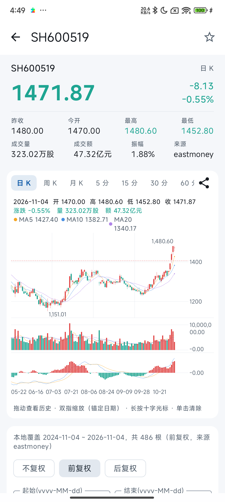
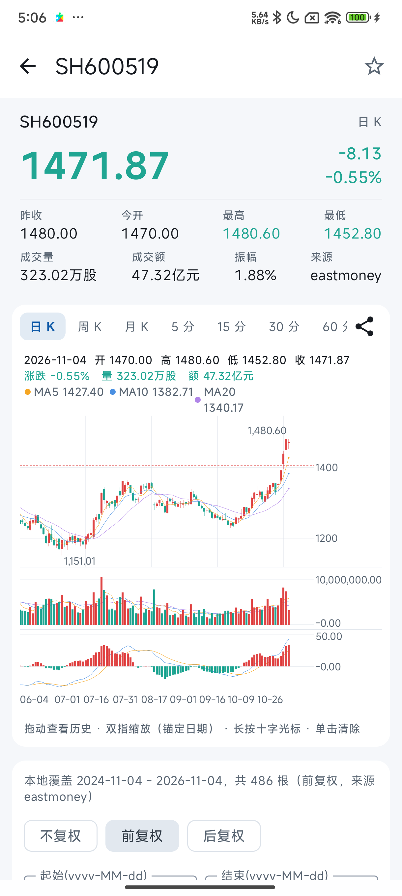

# Catnip 宿主 0.16.0-beta03 右轴自适应槽宽验证（issue #1 复测关闭记录）

- 日期：2026-11-06
- 关联 issue：#1（VOL 副图右轴大数量级刻度在固定轴槽内换行，rightAxisGutter=46dp）
- 验证版本：lkanvas-compose / lkanvas-core **0.16.0-beta03**（JitPack，宿主依赖解析确认同版本）
- 修复内容：右轴自适应槽宽（上游 yAxis.size='auto' 平台移植，R11-01）

## 复测环境

| 项 | 值 |
|---|---|
| 宿主 | Catnip（`com.github.IAmKings.LKanvas:lkanvas-compose:0.16.0-beta03`） |
| 设备 | 小米 K60U（23078PND5G）真机 |
| 数据 | SH600519 贵州茅台，本地前复权日 K 486 根（2024-11-04 ~ 2026-11-04） |
| 宿主配置 | `ChartLayoutConfig(rightAxisGutter = 46.dp)` **原配置未改动**（与手势测试的轴槽几何假设一致） |

## 结果

| 项目 | beta02（修复前） | beta03（修复后） |
|---|---|---|
| VOL 副图右轴最大刻度 | `10,000,0` / `00.00` 两行换行 | **`10,000,000.00` 单行完整** |
| 主图价格刻度 | 单行正常 | `1400` / `1200` 单行正常 |
| MACD 副图刻度 | 正常 | `50.00` / `-0.00` 正常 |
| 稳定性 | — | logcat 无 FATAL；宿主单元测试全绿 |

### 修复前（beta02，同机同标的）

### 修复后（beta03，同机同标的）

## 行为备注

beta03 在宿主 46dp 显式槽宽配置下按内容需要自适应加宽右轴槽
（`10,000,000.00` 全文单行所需宽于 46dp），主图/副图绘图区相应收窄，
「刻度在轴槽内单行完整显示」的验收目标达成。

若下游需要「严格锁定 46dp 固定槽宽 + 压缩数字格式（如 1.0亿/1000万）」的行为，
建议另立 issue 讨论（上游压缩格式口径需与 KLineChart v10 对齐）。

## 结论

issue #1 验收目标在真机复测中达成，回填截图后关闭。
