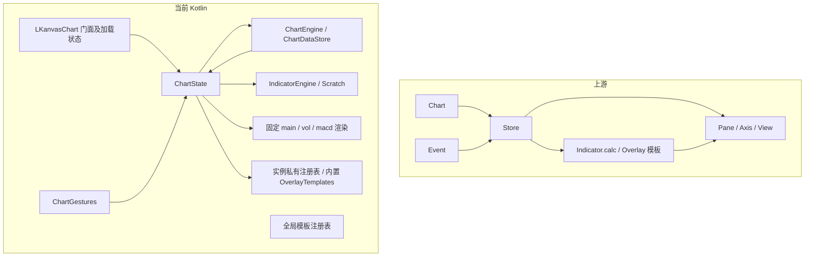

# Compose 工程与 KLineChart 上游结构、逻辑一致性审计

- 审计日期：2026-10-28（Asia/Shanghai）。
- 本地提交：`3fd49ff104021efbca2b5bebf41fcae3b3b26aa2`；开始审计时工作区干净。
- 审计对象：`lkanvas-core`、`lkanvas-compose`，以及上游快照、对齐台账、测试和同步工具。
- 主要验收标准：保留上游可迁移部分的模块职责、数据结构、调用顺序、条件分支和算法表达，使后续补丁可以局部对应移植。
- 本次交付：审计报告；没有修改工程实现、测试源码、构建配置或上游快照。

## 1. 审计结论

**当前版本未达到“结构与逻辑尽可能保持上游一致、便于持续局部同步”的验收要求。**

这是一个已有数值验证基础的原生重实现，后续增加了部分同名 API 门面。它还不是上游源码的结构保持型 Kotlin 移植。已有成果可以继续使用，但不能从“27 个指标通过”“矩阵 E=0”推导出内部结构、完整运行行为或升级维护成本已经对齐。

| 判断项 | 结果 | 结论边界 |
|---|---|---|
| 上游版本基线 | 通过 | 本地 `src/` 的 155 个文件与官方 v10.1.0 提交逐文件字节比较一致 |
| 是否漏同步 v10.1.0 之后的 main 源码 | 本次检查未发现 | 官方 compare 仅有一笔 README 文档提交，不能据此推导 Kotlin 实现已对齐 |
| 内置指标默认样本数值 | 通过现有样本 | 27 份样本重新生成后与仓库一致；测试验证有效值误差及 Missing 位置 |
| 文件、职责与调用结构 | 不通过 | 上游 Store/Pane/View/模板职责被重新拆分、合并，缺少可执行的逐符号实现映射 |
| 算法代码形态与控制流 | 不通过 | 全量 `calc` 被改为 Scratch 状态机；部分公式仍可辨认，但不再能直接按原函数对照补丁 |
| API、状态机与配置行为 | 不通过 | 存在注册后不可创建、分页不触发、切品种加载错误、配置无消费者等具体差异 |
| 小补丁同步能力 | 尚未证明 | 同步演练处理的是文档提交，尚无源码补丁局部移植证据 |

**不能保证未来每次更新都能避免重新理解和改写相关逻辑。** 也没有证据证明每次升级都必须重写整个库；目前能确认的是，多处上游变更需要人工重新映射到不同的本地模块，有些行为还需要先补齐调用链。

### 1.1 原有验收口径与本次要求不同

原 PRD 明确写明“不逐字兼容”方法名、动态对象结构和回调签名，并允许调整内部类结构、不为每个上游文件建立 Kotlin 对应类。见 [PRD:99](/Users/pauldeman/Documents/ai_workspace/KKLineChart/docs/PRD-KLineChart-Kotlin-Compose.zh-CN.md:99)、[PRD:160](/Users/pauldeman/Documents/ai_workspace/KKLineChart/docs/PRD-KLineChart-Kotlin-Compose.zh-CN.md:160)。

所以，过去按“原生领域能力等价”推进的实现，即便通过原有部分验收，也不自动满足本次更严格的结构保持要求。本报告以本次要求为准，不擅自改写旧 PRD 或替工程重构。

### 1.2 基线与版本标识

上游 v10.1.0 对应提交为 `d5bb26f706a6bd8f67eed4ecbbf22cb67a0725df`。本次从该提交下载源码归档并比较 `src/`：本地 155 文件、远端 155 文件，修改、缺失、额外文件均为 0。

2026-10-28 查询的 [官方 compare](https://github.com/klinecharts/KLineChart/compare/v10.1.0...main) 显示 main 仅领先一笔 `e52ec09eab7ab4498a99d058cc921c1931e6aad0`，修改 `README.md` 与 `README.zh-CN.md`；固定比较入口为 [d5bb26f…e52ec09](https://github.com/klinecharts/KLineChart/compare/d5bb26f706a6bd8f67eed4ecbbf22cb67a0725df...e52ec09eab7ab4498a99d058cc921c1931e6aad0)。这只证明本次比较范围没有新源码补丁。

工程发布脚本和 core 标识为 `0.2.0`，门面 `LKanvasChart.VERSION` 仍为 `0.2.0-alpha01`。本报告以提交 SHA 定位对象，避免版本字符串歧义。见 [publishing.gradle.kts:22](/Users/pauldeman/Documents/ai_workspace/KKLineChart/gradle/publishing.gradle.kts:22)、[LKanvas.kt:5](/Users/pauldeman/Documents/ai_workspace/KKLineChart/lkanvas-core/src/main/kotlin/io/lkanvas/core/LKanvas.kt:5)、[LKanvasChart.kt:36](/Users/pauldeman/Documents/ai_workspace/KKLineChart/lkanvas-compose/src/main/kotlin/io/lkanvas/chart/LKanvasChart.kt:36)。

## 2. 验收方法

跨 TypeScript 与 Kotlin 不要求标点、语言关键字逐字相同。`number` 到合适的 Kotlin 数值类型、可选值到可空类型、Canvas 到 Compose 绘制、DOM 生命周期到 Android 生命周期，都可以是必要适配。

但“适配”必须有边界：同一领域规则不应无记录地改默认值、改变分支顺序、移除回调、把执行方法改成 getter/setter 存储，或者让新增运行框架成为同步算法的前置条件。

| 验收维度 | 通过条件 | 本次结果 |
|---|---|---|
| S1 来源可追溯 | 基线 SHA、上游文件/符号、本地符号、差异及测试可定位 | 部分通过：基线可靠；台账偏向能力描述，未建立完整实现映射 |
| S2 职责结构 | 可迁移的领域职责对应；平台替换集中在边界 | 不通过 |
| S3 算法形态 | 主循环、状态、分支、公式与预热顺序可以直接对照 | 不通过；MACD 等部分表达仍接近 |
| L1 数据与状态机 | init/forward/backward/update、切会话、订阅顺序对应 | 不通过 |
| L2 公共契约 | 默认参数、返回结构、过滤与批量行为对应 | 不通过 |
| L3 扩展与绘制 | 注册、实例化、计算、绘制、命中和回调形成完整链路 | 不通过 |
| V1 差分验证 | 共同输入驱动两端，比对数值、状态、事件和几何 | 部分通过：指标固定数值样本较完整，其余明显不足 |
| U1 升级演练 | 一个真实源码补丁可定位为有限本地改动，回归可复现 | 未证明 |

不计算“源码一致率百分比”：跨语言文本相似率不能代表行为一致；现有矩阵也不包含计算这种比例所需的实现证据。

## 3. 结构映射与同步成本

生产 Kotlin 源码共 47 文件：core 23 文件、4,771 行；compose 24 文件、4,904 行。行数仅用于界定审计规模，不用于推导质量或一致率。

| 上游职责 | 本地对应 | 结构判断及后续升级影响 |
|---|---|---|
| `Chart.ts` | `chart/LKanvasChart.kt` + `compose/state/ChartState.kt` | 门面保留部分名称，参数、默认行为和执行分工改变；一个上游方法补丁可能需要跨两层检查 |
| `Store.ts` | `ChartDataStore.kt`、`ChartEngine.kt`、`ChartLoader.kt`、`Viewport.kt`、门面及 ChartState | 数据、加载、视口、事件被重新分散；门面 DataLoader 又有独立的加载变量和流程 |
| `component/Indicator.ts` | `IndicatorEngine.kt` 内多个类型 | 模板/实例/执行模型重新设计；回调存在类型或执行差异 |
| 27 个 `extension/indicator/*.ts` | `BuiltInIndicators.kt`、`WindowIndicators.kt`、`OscillatorIndicators.kt`、`RecursiveIndicators.kt` | 27 模板合并为 4 文件，算法改为增量状态机；定位公式补丁需要语义映射 |
| `component/Overlay.ts` | `OverlayManager.kt` + `OverlayTemplates.kt` + `OverlayApi.kt` | 生命周期、公共类型和模板拆开；实例没有持有完整模板行为链 |
| 16 个 `extension/overlay/*.ts` | `OverlayTemplates.kt` + `OverlayGeometry.kt` + `OverlayRenderer.kt` | 模板生成图形改为按名称集中分支，新增/修改模板可能要改定义、绘制、命中多处 |
| `pane/*`、`widget/*`、`view/*` | `ChartState.PaneHeights` + `ChartRenderer.kt` + `PaneRenderers.kt` | 原生绘制替换合理；但动态 pane 和通用指标渲染的领域行为也被简化 |
| `component/Axis/XAxis/YAxis`、轴模板 | `YAxisSpec.kt`、`LinearYAxis.kt`、`AxisApi.kt`、门面轴记录表 | 数学轴与门面轴状态不是同一条执行链 |
| `Event.ts`、`Eventful` | `ChartGestures.kt` + ChartState 方法 | 触摸入口适配合理；开关、锚点及事件执行语义仍应保留 |
| `common/Styles.ts` | `styles/Styles.kt` + `StylesMerge.kt` + `StylesThemeBridge.kt` + `ChartTheme.kt` | 样式树相近，但经另一套主题模型压缩，部分字段丢失或只存不消费 |
| `extension/*/index.ts` 注册表 | `LkanvasRegistry` 与 ChartState 私有注册表、OverlayTemplates | 查询注册表和实际创建使用不同数据源 |

主要数据路径可以概括为：



右图中全局模板表未接入实例创建，是实际调用断点。上述结构变化本身不等于代码质量差；它们意味着不能把上游补丁按相同文件和函数直接移植。

## 4. 已有的可靠基础

1. **上游快照可靠。** 已核验官方提交与全部本地上游源码，避免了拿修改过的 oracle 自证一致。
2. **27 个指标的默认数值样本可重现。** 重新运行 TS 模板生成器到临时目录，27 个 JSON 与仓库按解析后内容比较全部相等。Kotlin oracle 测试以 `1e-9 + 1e-10 × max(abs(a),abs(b))` 比较有效值，并检查 null/NaN 位置；这是误差预算内逐位置一致，不是浮点二进制逐位相等。见 [gen-fixtures.ts:112](/Users/pauldeman/Documents/ai_workspace/KKLineChart/tools/oracle/gen-fixtures.ts:112)、[BuiltinIndicatorOracleTest.kt:64](/Users/pauldeman/Documents/ai_workspace/KKLineChart/lkanvas-core/src/test/kotlin/io/lkanvas/core/indicator/builtin/BuiltinIndicatorOracleTest.kt:64)。
3. **部分公式可直接辨认。** 例如 MACD 的 EMA 种子、DIF/DEA 预热条件、乘 2 的柱值公式仍可对应；但其函数分解和状态所有权已经改变。见 [上游 MACD:62](/Users/pauldeman/Documents/ai_workspace/KKLineChart/third_party/klinechart-v10.1.0/src/extension/indicator/movingAverageConvergenceDivergence.ts:62)、[本地 MACD:157](/Users/pauldeman/Documents/ai_workspace/KKLineChart/lkanvas-core/src/main/kotlin/io/lkanvas/core/indicator/builtin/BuiltInIndicators.kt:157)。
4. **本地回归测试全部通过。** 本次禁用构建缓存后实际执行：core 216、compose 79，共 295 个，失败/错误/跳过均为 0。这表明现有本地约定受到一定保护，并不能覆盖下面尚未被断言的上游契约。
5. **部分有意差异已有登记。** D-01 零基准百分比、D-02 斐波那契价格空间投影、D-03 缺失值处理是已记录的设计选择。严格验收需要逐项批准这些例外，不应把它们静默计入“完全一致”。

## 5. 必须解决的验收阻断

以下“必须”指达到本次结构/逻辑验收所必需，不等同于要求立刻重构全部工程。每项给出具体情形、证据、最小处理方向与不处理的影响。

### 1. 验收工具证明的是台账覆盖，不能证明实现一致

**问题：** `check.py` 读取上游源码、gap-matrix 和 ts-inventory；不读取 Kotlin 实现，不确认“test/diff”是否真的执行，也不比较调用结构。只存字段、只建回调类型的条目仍可归为 B，并得到 E=0。

**证据：** [check.py:24](/Users/pauldeman/Documents/ai_workspace/KKLineChart/tools/alignment/check.py:24)、[check.py:108](/Users/pauldeman/Documents/ai_workspace/KKLineChart/tools/alignment/check.py:108)、[check.py:223](/Users/pauldeman/Documents/ai_workspace/KKLineChart/tools/alignment/check.py:223)。[gap-matrix:121](/Users/pauldeman/Documents/ai_workspace/KKLineChart/docs/alignment/gap-matrix.md:121) 把仅登记多轴的实现列为 B；[gap-matrix:201](/Users/pauldeman/Documents/ai_workspace/KKLineChart/docs/alignment/gap-matrix.md:201) 也将 figure 回调建模位列为 B。

**最小处理方向：** 保留该脚本的文档校验职责；验收时另要求条目关联真实本地符号、调用消费者和具体断言。增加“已声明/已接线/行为通过/结构可对应”状态，避免把 B 自动当作完成。

**不处理：** 后续升级仍可能把新增 API 名称和字段视为已移植，关键逻辑缺口继续被绿色统计掩盖。

### 2. 指标执行模型已经重写，未保留上游全量函数结构

**问题：** 上游模板以一个 `calc(dataList, indicator)` 管理状态、主循环和输出行。本地强制拆为 `initScratch`、`stepScratch`、`rowFromScratch`，输出由行对象改为列数组。MA 还将“输出后减旧值”改为“下一步输出前减旧值”。数学结果在样本中可一致，但状态不变量与更新位置不同。

**证据：** [上游 movingAverage.ts:41](/Users/pauldeman/Documents/ai_workspace/KKLineChart/third_party/klinechart-v10.1.0/src/extension/indicator/movingAverage.ts:41)、[BuiltInIndicators.kt:30](/Users/pauldeman/Documents/ai_workspace/KKLineChart/lkanvas-core/src/main/kotlin/io/lkanvas/core/indicator/builtin/BuiltInIndicators.kt:30)、[IndicatorEngine.kt:52](/Users/pauldeman/Documents/ai_workspace/KKLineChart/lkanvas-core/src/main/kotlin/io/lkanvas/core/indicator/IndicatorEngine.kt:52)。

**具体影响：** 若上游修复 MA 的窗口维护或 MACD 的状态初始化，需要重新判断本地 Scratch 对应哪一个时刻，不能直接搬运同一代码块。

**最小处理方向：** 后续变更优先保留可对照的全量 `calc` 入口和原有运算顺序，再把增量能力作为有明确来源映射的优化；现有增量测试和性能结果应保留。不要为本次审计先批量改写 27 个指标。

**不处理：** 继续承担算法补丁的人工再推导成本；数值通过也无法满足结构验收。

### 3. 动态 pane 和通用指标绘制被固定三 pane 管线替代

**问题：** 上游 `createIndicator("RSI")` 默认生成指标 pane，`isStack` 默认 false。本地默认 `paneId="main"`、`isStack=true`，实际忽略 isStack；渲染只固定调用 main、VOL、MACD。主 pane 只选 PRICE 系指标，副 pane 只读内置 VOL/MACD 结果。

**证据：** [Chart.ts:802](/Users/pauldeman/Documents/ai_workspace/KKLineChart/third_party/klinechart-v10.1.0/src/Chart.ts:802)、[ChartState.kt:98](/Users/pauldeman/Documents/ai_workspace/KKLineChart/lkanvas-compose/src/main/kotlin/io/lkanvas/compose/state/ChartState.kt:98)、[ChartState.kt:633](/Users/pauldeman/Documents/ai_workspace/KKLineChart/lkanvas-compose/src/main/kotlin/io/lkanvas/compose/state/ChartState.kt:633)、[ChartRenderer.kt:47](/Users/pauldeman/Documents/ai_workspace/KKLineChart/lkanvas-compose/src/main/kotlin/io/lkanvas/compose/draw/ChartRenderer.kt:47)、[PaneRenderers.kt:143](/Users/pauldeman/Documents/ai_workspace/KKLineChart/lkanvas-compose/src/main/kotlin/io/lkanvas/compose/draw/PaneRenderers.kt:143)。

**复现：** 创建 RSI 返回有效 ID，实例有计算结果，但不进入主 pane 的指标结果列表，也不会新增 pane；传入其他 paneId 也没有对应的通用绘制路径。

**最小处理方向：** 让 pane 列表及每 pane 的指标/轴集合成为统一来源，渲染遍历该集合；先贯通一个普通副图指标，再逐步移除特殊分支。

**不处理：** “27 指标计算可用”无法扩展为“27 指标在 Compose 图表中可按上游方式使用”；pane/view 相关补丁需要持续重实现。

### 4. 全局模板注册与创建路径断开

**问题：** `LkanvasRegistry.registerIndicator` 写全局 indicators，ChartState 创建只查自己注册的 27 内置模板。覆盖物注册写全局 overlays，门面创建却只查 `OverlayTemplates`。注册轴模板和自定义 locale 也没有被对应门面配置路径实际解析使用。

**证据：** [LkanvasRegistry.kt:50](/Users/pauldeman/Documents/ai_workspace/KKLineChart/lkanvas-compose/src/main/kotlin/io/lkanvas/chart/LkanvasRegistry.kt:50)、[ChartState.kt:48](/Users/pauldeman/Documents/ai_workspace/KKLineChart/lkanvas-compose/src/main/kotlin/io/lkanvas/compose/state/ChartState.kt:48)、[ChartState.kt:106](/Users/pauldeman/Documents/ai_workspace/KKLineChart/lkanvas-compose/src/main/kotlin/io/lkanvas/compose/state/ChartState.kt:106)、[LKanvasChart.kt:522](/Users/pauldeman/Documents/ai_workspace/KKLineChart/lkanvas-compose/src/main/kotlin/io/lkanvas/chart/LKanvasChart.kt:522)、[LKanvasChart.kt:597](/Users/pauldeman/Documents/ai_workspace/KKLineChart/lkanvas-compose/src/main/kotlin/io/lkanvas/chart/LKanvasChart.kt:597)。上游创建查同一个注册入口：[Store.ts:1397](/Users/pauldeman/Documents/ai_workspace/KKLineChart/third_party/klinechart-v10.1.0/src/Store.ts:1397)。

**复现：** 注册 `AUDIT_MA` 或 `AUDIT_OVERLAY` 后，getSupported 查询中能看到模板，图表 create 返回 null；在注册后新建图表同样如此。

**最小处理方向：** 统一注册查询来源，并让实例继续持有独立计算状态；不能只把当前全局表复制到新实例而忽略既有实例的注册语义。

**不处理：** 上游模板迁移和宿主扩展必须绕开门面、修改内部注册或渲染代码。

### 5. 门面分页没有触发入口，more 方向赋值也与上游相反

**问题：** `processLoad` 唯一调用传 INIT，没有 FORWARD/BACKWARD 调用；范围变化只发送事件，不检查加载边界。即便日后加上入口，BACKWARD 分支写的是 `realMore.forward`，FORWARD 写的是 `realMore.backward`，与上游各自更新同名方向相反。

**证据：** [LKanvasChart.kt:339](/Users/pauldeman/Documents/ai_workspace/KKLineChart/lkanvas-compose/src/main/kotlin/io/lkanvas/chart/LKanvasChart.kt:339)、[LKanvasChart.kt:390](/Users/pauldeman/Documents/ai_workspace/KKLineChart/lkanvas-compose/src/main/kotlin/io/lkanvas/chart/LKanvasChart.kt:390)、[ChartState.kt:519](/Users/pauldeman/Documents/ai_workspace/KKLineChart/lkanvas-compose/src/main/kotlin/io/lkanvas/compose/state/ChartState.kt:519)；对照 [Store.ts:633](/Users/pauldeman/Documents/ai_workspace/KKLineChart/third_party/klinechart-v10.1.0/src/Store.ts:633)、[Store.ts:771](/Users/pauldeman/Documents/ai_workspace/KKLineChart/third_party/klinechart-v10.1.0/src/Store.ts:771)。

**复现：** 初始返回双向 more=true，滚动到两端，getBars 调用序列仍只有 INIT。core 的另一套 `ChartLoader.loadMoreEarlier` 存在，不代表门面已经接入它。

**最小处理方向：** 在唯一的可见范围调整流程连接边界判定、loading 和同方向 more 更新；以双向 more 不同值测试，避免两个布尔同为 true/false 掩盖赋值错误。

**不处理：** 采用 README 门面 DataLoader 的宿主不能按上游方式自动分页。

### 6. 切品种/周期/数据源没有保持上游重置和退订顺序

**问题：** 门面先覆盖 symbol/dataLoader，再调用 reset；reset 没有退订旧源，也没有清除 loading。A 请求未完成时切 B，B 请求被 `if (loading) return` 跳过；A 回调随后以 `currentKey()` 写入 B 会话。core 的会话门禁无法识别这次由门面重新打上当前 key 的旧数据。

**证据：** [LKanvasChart.kt:71](/Users/pauldeman/Documents/ai_workspace/KKLineChart/lkanvas-compose/src/main/kotlin/io/lkanvas/chart/LKanvasChart.kt:71)、[LKanvasChart.kt:323](/Users/pauldeman/Documents/ai_workspace/KKLineChart/lkanvas-compose/src/main/kotlin/io/lkanvas/chart/LKanvasChart.kt:323)、[LKanvasChart.kt:332](/Users/pauldeman/Documents/ai_workspace/KKLineChart/lkanvas-compose/src/main/kotlin/io/lkanvas/chart/LKanvasChart.kt:332)、[LKanvasChart.kt:384](/Users/pauldeman/Documents/ai_workspace/KKLineChart/lkanvas-compose/src/main/kotlin/io/lkanvas/chart/LKanvasChart.kt:384)；上游顺序为退订旧上下文、修改配置、清 loading、init：[Store.ts:818](/Users/pauldeman/Documents/ai_workspace/KKLineChart/third_party/klinechart-v10.1.0/src/Store.ts:818)。

**复现：** 延迟 A 的 init 回调，切 B；请求记录只有 A，getSymbol 为 B；执行 A 回调后，A 的 candle 出现在 marketKey=B 的数据中。另一个复现中 A、B 都已订阅，但切换时没有任何 unsubscribe 调用。

**最小处理方向：** 先恢复上游旧上下文退订与重置顺序；再用请求代次绑定本地异步回调，避免旧会话数据被重新标记为当前数据。上游这段源码本身也没有完整请求代次门禁，本报告不声称它解决了所有异步竞态。

**不处理：** 不同品种的行情可能混入同一图表，这是直接的数据正确性风险。

### 7. 指标 CRUD 的批量、替换和默认实例语义改变

**问题：** 本地 removeIndicator 只删除第一个匹配，且内置三实例不可删除；上游按过滤范围删除，并在非叠加创建时移除同 pane 指标。ChartState 的 `isStack` 不参与创建，过滤表达式 `(f.isStack == null || true)` 恒成立。overrideIndicator 也仅支持 id、参数与 visible。

**证据：** [ChartState.kt:123](/Users/pauldeman/Documents/ai_workspace/KKLineChart/lkanvas-compose/src/main/kotlin/io/lkanvas/compose/state/ChartState.kt:123)、[ChartState.kt:147](/Users/pauldeman/Documents/ai_workspace/KKLineChart/lkanvas-compose/src/main/kotlin/io/lkanvas/compose/state/ChartState.kt:147)、[LKanvasChart.kt:435](/Users/pauldeman/Documents/ai_workspace/KKLineChart/lkanvas-compose/src/main/kotlin/io/lkanvas/chart/LKanvasChart.kt:435)；对照 [Chart.ts:867](/Users/pauldeman/Documents/ai_workspace/KKLineChart/third_party/klinechart-v10.1.0/src/Chart.ts:867)、[Store.ts:1402](/Users/pauldeman/Documents/ai_workspace/KKLineChart/third_party/klinechart-v10.1.0/src/Store.ts:1402)。上游初始化只建 candle/x-axis pane，没有默认创建这三个指标：[Chart.ts:148](/Users/pauldeman/Documents/ai_workspace/KKLineChart/third_party/klinechart-v10.1.0/src/Chart.ts:148)。

**复现：** 创建两个 RSI 后无参 removeIndicator，一次仅删除一个；仍留下另一个 RSI 和三内置实例。

**最小处理方向：** 对齐创建默认值、按 pane 替换和按 filter 删除全部目标；示例需要的 MA/VOL/MACD 由示例显式创建。避免以不可删除的内置实例固定产品布局。

**不处理：** 宿主的切指标、清图、pane 替换代码不能按相同调用意图迁移。

### 8. 参数改变时没有按实例重新生成输出列

**问题：** `plotsFor(params)` 已存在，但 `IndicatorEngine.recompute` 仍按 `definition.plots` 分配固定列。MA 输出键数随参数个数改变，超过默认四列后写入 ma5 会失败；异常被 computeInto 捕获，实例转错误而不是正常显示。

**证据：** [IndicatorEngine.kt:220](/Users/pauldeman/Documents/ai_workspace/KKLineChart/lkanvas-core/src/main/kotlin/io/lkanvas/core/indicator/IndicatorEngine.kt:220)、[IndicatorEngine.kt:347](/Users/pauldeman/Documents/ai_workspace/KKLineChart/lkanvas-core/src/main/kotlin/io/lkanvas/core/indicator/IndicatorEngine.kt:347)、[BuiltInIndicators.kt:27](/Users/pauldeman/Documents/ai_workspace/KKLineChart/lkanvas-core/src/main/kotlin/io/lkanvas/core/indicator/builtin/BuiltInIndicators.kt:27)；上游按参数生成 figures：[movingAverage.ts:40](/Users/pauldeman/Documents/ai_workspace/KKLineChart/third_party/klinechart-v10.1.0/src/extension/indicator/movingAverage.ts:40)。

**复现：** 在有数据的图表创建 MA，参数 `[3,5,8,13,21]`，得到 ID，但实例 error 非空、state 为 null。

**最小处理方向：** 计算与渲染共同采用实例参数生成的 figures/plots，参数变化时一起失效重建。增加参数个数增减的差分用例。

**不处理：** 默认样本全部通过仍会漏掉上游允许的动态参数行为。

### 9. Styles 的默认值被误当成“未提供”，无法恢复默认设置

**问题：** merge 将“patch 值等于默认实例值”视为没有传入，丢失“显式设回默认值”与“未设置”的区别。上游按提供的属性合并，没有该规则。

**证据：** [StylesMerge.kt:13](/Users/pauldeman/Documents/ai_workspace/KKLineChart/lkanvas-compose/src/main/kotlin/io/lkanvas/chart/styles/StylesMerge.kt:13)、[StylesMerge.kt:42](/Users/pauldeman/Documents/ai_workspace/KKLineChart/lkanvas-compose/src/main/kotlin/io/lkanvas/chart/styles/StylesMerge.kt:42)；对照 [typeChecks.ts:16](/Users/pauldeman/Documents/ai_workspace/KKLineChart/third_party/klinechart-v10.1.0/src/common/utils/typeChecks.ts:16)。

**复现：** `setStyles(Styles(grid=GridStyle(show=false)))` 后，再设置 show=true，getStyles.grid.show 仍为 false。线宽恢复默认、颜色恢复默认也受同一规则影响。

**最小处理方向：** patch 必须表达属性是否实际提供；用字段存在信息或明确的 patch 类型，保留显式默认值。直接把现有完整 Styles 换为 mergeStrict 会覆盖未指定的其他设置，不能作为完整修复。

**不处理：** 样式面板出现单向修改，且样式补丁的逻辑不再与上游相同。

### 10. 多轴接口只管理记录，未进入实际坐标和渲染链

**问题：** create/overrideYAxis 改门面的 yAxes 表，overrideXAxis 改 xAxisState；绘制读取 ChartState.mainAxisSpec 和固定单轴。实例 yAxisId 可存储但未用于选轴，注册模板也未用于构造轴。createYAxis 仅排除 x-axis ID，未按上游校验目标 pane 是否存在。

**证据：** [LKanvasChart.kt:713](/Users/pauldeman/Documents/ai_workspace/KKLineChart/lkanvas-compose/src/main/kotlin/io/lkanvas/chart/LKanvasChart.kt:713)、[LKanvasChart.kt:723](/Users/pauldeman/Documents/ai_workspace/KKLineChart/lkanvas-compose/src/main/kotlin/io/lkanvas/chart/LKanvasChart.kt:723)、[LKanvasChart.kt:770](/Users/pauldeman/Documents/ai_workspace/KKLineChart/lkanvas-compose/src/main/kotlin/io/lkanvas/chart/LKanvasChart.kt:770)、[PaneRenderers.kt:61](/Users/pauldeman/Documents/ai_workspace/KKLineChart/lkanvas-compose/src/main/kotlin/io/lkanvas/compose/draw/PaneRenderers.kt:61)；上游操作真实 pane 轴组件：[Chart.ts:1003](/Users/pauldeman/Documents/ai_workspace/KKLineChart/third_party/klinechart-v10.1.0/src/Chart.ts:1003)。

**复现：** overrideYAxis(main, reverse=true)，getYAxes 显示 reverse=true，同一数据点的 convertToPixel 坐标完全不变。绘制端也没有读取这张记录表。

**最小处理方向：** 让公共轴实例成为绘制和坐标转换共同消费的轴来源；先贯通单 pane 的一个额外轴，包含注册、绑定、布局、转换与删除保护。

**不处理：** 多轴记录测试通过会被误解为多轴图表能力已经实现，上游轴补丁仍无对应执行位置。

### 11. 开关、格式与部分 Styles 配置没有消费者

**问题：** scrollEnabled、zoomEnabled、zoomAnchor 只存于门面，手势和 ChartState 滚动缩放不读取它们。timezone、formatter、thousandsSeparator、decimalFold 也仅 set/get；ChartText 使用系统时区和自己的格式器。Styles 经 ChartTheme 桥接丢失部分语义，例如 candle.type 不设置实际 mainChartType，bar 回调没有逐 candle 消费路径。

**证据：** [LKanvasChart.kt:198](/Users/pauldeman/Documents/ai_workspace/KKLineChart/lkanvas-compose/src/main/kotlin/io/lkanvas/chart/LKanvasChart.kt:198)、[LKanvasChart.kt:610](/Users/pauldeman/Documents/ai_workspace/KKLineChart/lkanvas-compose/src/main/kotlin/io/lkanvas/chart/LKanvasChart.kt:610)、[ChartState.kt:501](/Users/pauldeman/Documents/ai_workspace/KKLineChart/lkanvas-compose/src/main/kotlin/io/lkanvas/compose/state/ChartState.kt:501)、[ChartGestures.kt:33](/Users/pauldeman/Documents/ai_workspace/KKLineChart/lkanvas-compose/src/main/kotlin/io/lkanvas/compose/gesture/ChartGestures.kt:33)、[ChartText.kt:34](/Users/pauldeman/Documents/ai_workspace/KKLineChart/lkanvas-compose/src/main/kotlin/io/lkanvas/compose/draw/ChartText.kt:34)、[StylesThemeBridge.kt:15](/Users/pauldeman/Documents/ai_workspace/KKLineChart/lkanvas-compose/src/main/kotlin/io/lkanvas/compose/theme/StylesThemeBridge.kt:15)、[PaneRenderers.kt:229](/Users/pauldeman/Documents/ai_workspace/KKLineChart/lkanvas-compose/src/main/kotlin/io/lkanvas/compose/draw/PaneRenderers.kt:229)。上游在公共执行路径检查开关：[Store.ts:930](/Users/pauldeman/Documents/ai_workspace/KKLineChart/third_party/klinechart-v10.1.0/src/Store.ts:930)、[Store.ts:1223](/Users/pauldeman/Documents/ai_workspace/KKLineChart/third_party/klinechart-v10.1.0/src/Store.ts:1223)。

**复现：** setScrollEnabled(false) 后 scrollByDistance 仍改变视口；setZoomEnabled(false) 后 zoomAtCoordinate(2) 仍使间距加倍。时间格式路径经源码追踪确认，不属于本次截图验证结果。

**最小处理方向：** 在共用状态/执行入口读取配置，使程序调用与手势共同遵守；将格式配置接到同一文本格式链。逐字段记录 Styles 的实际消费者，避免再增加一层仅转存的模型。

**不处理：** 同名 setter 能回读却不能控制图表，上游新增配置也容易重复成为空接线。

### 12. 数据与像素转换没有共用正在绘制的轴模型

**问题：** 主图绘制使用 YAxisMath 和 effectiveMainAxisSpec；mainPaneYOf/mainPaneValueAt 直接用 LinearYAxis。覆盖物和门面 convert 方法调用后者。convertFromPixel 还复用受磁吸模式影响的覆盖物输入逻辑，且没有上游的 pane/yAxis/absolute filter。

**证据：** [ChartState.kt:327](/Users/pauldeman/Documents/ai_workspace/KKLineChart/lkanvas-compose/src/main/kotlin/io/lkanvas/compose/state/ChartState.kt:327)、[ChartState.kt:370](/Users/pauldeman/Documents/ai_workspace/KKLineChart/lkanvas-compose/src/main/kotlin/io/lkanvas/compose/state/ChartState.kt:370)、[LKanvasChart.kt:227](/Users/pauldeman/Documents/ai_workspace/KKLineChart/lkanvas-compose/src/main/kotlin/io/lkanvas/chart/LKanvasChart.kt:227)、[PaneRenderers.kt:62](/Users/pauldeman/Documents/ai_workspace/KKLineChart/lkanvas-compose/src/main/kotlin/io/lkanvas/compose/draw/PaneRenderers.kt:62)；上游按过滤条件定位真实轴：[Chart.ts:1201](/Users/pauldeman/Documents/ai_workspace/KKLineChart/third_party/klinechart-v10.1.0/src/Chart.ts:1201)。

**复现：** 切 Logarithm 后，同一 value 的 convertToPixel.y 与渲染使用的 YAxisMath.valueToY 相差超过 0.5 px。线性转换互为逆函数的测试即使通过，也证明不了它们与屏幕一致。

**最小处理方向：** 绘制、十字线、覆盖物和公共转换统一使用相同 pane/轴映射；通用坐标转换与磁吸分开。补 log/custom 以及副 pane 的转换断言。

**不处理：** 非线性轴下画线、API 坐标和 candle 位置不能保持一致；上游坐标修复需要检查多套公式。

### 13. 覆盖物模板回调未执行，交互创建还丢失配置

**问题：** 上游通过模板 createPointFigures、轴图形和事件回调完成扩展。本地虽然声明了若干钩子，却由 OverlayRenderer 的名称分支绘制，模板没有被完整传到实例执行链。styles、fixedZLevel、modeSensitivity 等有存储位置，但没有相应完整行为消费。无 points 的 createOverlay 分支直接 return，跳过 paneId/groupId/lock/visible 等应用。

**证据：** [OverlayTemplates.kt:53](/Users/pauldeman/Documents/ai_workspace/KKLineChart/lkanvas-core/src/main/kotlin/io/lkanvas/core/overlay/OverlayTemplates.kt:53)、[OverlayTemplates.kt:81](/Users/pauldeman/Documents/ai_workspace/KKLineChart/lkanvas-core/src/main/kotlin/io/lkanvas/core/overlay/OverlayTemplates.kt:81)、[OverlayManager.kt:121](/Users/pauldeman/Documents/ai_workspace/KKLineChart/lkanvas-core/src/main/kotlin/io/lkanvas/core/overlay/OverlayManager.kt:121)、[OverlayRenderer.kt:43](/Users/pauldeman/Documents/ai_workspace/KKLineChart/lkanvas-compose/src/main/kotlin/io/lkanvas/compose/draw/OverlayRenderer.kt:43)、[OverlayRenderer.kt:70](/Users/pauldeman/Documents/ai_workspace/KKLineChart/lkanvas-compose/src/main/kotlin/io/lkanvas/compose/draw/OverlayRenderer.kt:70)、[LKanvasChart.kt:523](/Users/pauldeman/Documents/ai_workspace/KKLineChart/lkanvas-compose/src/main/kotlin/io/lkanvas/chart/LKanvasChart.kt:523)。上游模板和执行点：[segment.ts:17](/Users/pauldeman/Documents/ai_workspace/KKLineChart/third_party/klinechart-v10.1.0/src/extension/overlay/segment.ts:17)、[OverlayView.ts:574](/Users/pauldeman/Documents/ai_workspace/KKLineChart/third_party/klinechart-v10.1.0/src/view/OverlayView.ts:574)。

**复现：** 不带 points 创建 segment，设置 paneId=vol、groupId=g、lock=true、visible=false；返回实例仍为 main、groupId=null、未锁定且可见。模板事件和绘图钩子不执行的结论来自生产调用点全局检索。

**最小处理方向：** 创建两条分支先共用配置应用过程；让模板生成图形、图形绘制/命中、模板事件形成统一链路，逐个替换集中名称分支。指标的 PlotDef.styles/attrs、draw、createTooltipDataSource 也应按同一原则验收，不能只验属性存在。

**不处理：** 内置图形看起来可用，但上游模板的行为补丁与自定义模板仍需修改核心分支。

### 14. 视口与公共 API 仍有可观察的契约差异

**问题与情形：**

- `zoomAtDataIndex` 先 scrollToIndex 居中再缩放；上游只以该索引当前像素为缩放锚点。scale=1 本应不产生缩放位移，本地仍先改变位置。
- `scrollToDataIndex` 在本地居中；上游按末根右侧距离模型定位，两者默认目标位置不同。
- 左右 maxOffset 共用 overscrollSlots，不能独立设置；上游保留 left/right 两值。rightOffsetDistance 转整型槽位，丢失不足一根的偏移。
- 门面 getVisibleRange 的 to 没有按数据数量钳制；上游 to 最大为数据长度。多个滚动/缩放 API 接收 animationDuration 但不执行动画。
- `setLayoutOptions/getLayoutOptions` 没有门面方法；`getConvertPictureUrl` 也未提供同名入口，存在独立 PNG exporter。这些适配和缺口应在迁移契约中明确区分。

**证据：** [LKanvasChart.kt:104](/Users/pauldeman/Documents/ai_workspace/KKLineChart/lkanvas-compose/src/main/kotlin/io/lkanvas/chart/LKanvasChart.kt:104)、[LKanvasChart.kt:111](/Users/pauldeman/Documents/ai_workspace/KKLineChart/lkanvas-compose/src/main/kotlin/io/lkanvas/chart/LKanvasChart.kt:111)、[LKanvasChart.kt:146](/Users/pauldeman/Documents/ai_workspace/KKLineChart/lkanvas-compose/src/main/kotlin/io/lkanvas/chart/LKanvasChart.kt:146)、[LKanvasChart.kt:162](/Users/pauldeman/Documents/ai_workspace/KKLineChart/lkanvas-compose/src/main/kotlin/io/lkanvas/chart/LKanvasChart.kt:162)、[Viewport.kt:95](/Users/pauldeman/Documents/ai_workspace/KKLineChart/lkanvas-core/src/main/kotlin/io/lkanvas/core/viewport/Viewport.kt:95)；对照 [Chart.ts:1161](/Users/pauldeman/Documents/ai_workspace/KKLineChart/third_party/klinechart-v10.1.0/src/Chart.ts:1161)、[Chart.ts:1191](/Users/pauldeman/Documents/ai_workspace/KKLineChart/third_party/klinechart-v10.1.0/src/Chart.ts:1191)、[Store.ts:731](/Users/pauldeman/Documents/ai_workspace/KKLineChart/third_party/klinechart-v10.1.0/src/Store.ts:731)、[Store.ts:902](/Users/pauldeman/Documents/ai_workspace/KKLineChart/third_party/klinechart-v10.1.0/src/Store.ts:902)。

**复现：** 有布局和足够数据时记录 index=120 的 x，调用 zoomAtDataIndex(1,120)，x 改变超过 100 px。

**最小处理方向：** 按上游当前坐标建立锚点，分别保存方向边界，保留小数偏移；对真正的平台替代明确公布对应调用和限制。不要仅通过名称对齐验收。

**不处理：** 上游交互示例和程序定位逻辑迁移后呈现不同结果，视口补丁需要重新解释坐标模型。

### 15. executeAction 与事件数据结构没有保持原语义

**问题：** 上游 executeAction(onCrosshairChange,data) 设置十字线状态，并抑制反向广播；本地对所有事件直接调用订阅者。点击 payload 上游为 `data:{prev,current,next}`，本地为独立 prev、data、next，结构不同。十字线 paneId 又被固定写为 main。

**证据：** [Chart.ts:1261](/Users/pauldeman/Documents/ai_workspace/KKLineChart/third_party/klinechart-v10.1.0/src/Chart.ts:1261)、[上游 Data.ts:36](/Users/pauldeman/Documents/ai_workspace/KKLineChart/third_party/klinechart-v10.1.0/src/common/Data.ts:36)、[LKanvasChart.kt:309](/Users/pauldeman/Documents/ai_workspace/KKLineChart/lkanvas-compose/src/main/kotlin/io/lkanvas/chart/LKanvasChart.kt:309)、[LKanvasChart.kt:263](/Users/pauldeman/Documents/ai_workspace/KKLineChart/lkanvas-compose/src/main/kotlin/io/lkanvas/chart/LKanvasChart.kt:263)、[ChartTypes.kt:33](/Users/pauldeman/Documents/ai_workspace/KKLineChart/lkanvas-compose/src/main/kotlin/io/lkanvas/chart/ChartTypes.kt:33)。

**复现：** 传入有效 Crosshair 执行 ON_CROSSHAIR_CHANGE 后，ChartState.crosshairPosition 仍为 null。

**最小处理方向：** 分开公共动作执行和内部事件广播，保持上游 payload 嵌套结构与 pane 来源；测试状态变化、回调顺序和次数。

**不处理：** 联动图表和宿主事件处理需要改变调用逻辑，仅同名的九种事件枚举不能代表兼容。

## 6. 应补强的验证与同步证据

### 16. 现有测试覆盖不足以充当结构和完整逻辑的发布门禁

**问题：** 测试通过的范围比文档“对齐完成”窄。指标 meta 测试中 `shouldOhlc/shouldFormatBigNumber` 用例从 TS fixture 自己构造并检查分布，没有逐模板读取 Kotlin 对应属性；部分 figures 只比集合、不比顺序。Styles 默认值测试仅断言部分手写常量。parity-1 验证初始加载和实时更新，没有驱动双向分页、在途切品种；parity-3 多为 set/get 和宽松结果检查。

**证据：** [IndicatorMetaDiffTest.kt:144](/Users/pauldeman/Documents/ai_workspace/KKLineChart/lkanvas-core/src/test/kotlin/io/lkanvas/core/indicator/builtin/IndicatorMetaDiffTest.kt:144)、[IndicatorMetaDiffTest.kt:163](/Users/pauldeman/Documents/ai_workspace/KKLineChart/lkanvas-core/src/test/kotlin/io/lkanvas/core/indicator/builtin/IndicatorMetaDiffTest.kt:163)、[StylesDefaultsTest.kt:30](/Users/pauldeman/Documents/ai_workspace/KKLineChart/lkanvas-compose/src/test/kotlin/io/lkanvas/chart/styles/StylesDefaultsTest.kt:30)、[Parity1DataLoaderTest.kt:125](/Users/pauldeman/Documents/ai_workspace/KKLineChart/lkanvas-compose/src/test/kotlin/io/lkanvas/chart/parity/Parity1DataLoaderTest.kt:125)、[upstream-sync.md:5](/Users/pauldeman/Documents/ai_workspace/KKLineChart/docs/upstream-sync.md:5)。

**最小处理方向：** 先把本次发现对应的共同输入与预期做成小型差分用例；再选一笔真实历史源码补丁，在临时分支完成映射、移植和回归，记录受影响符号。无需为了验收创建通用自动翻译框架。

**不处理：** 同步机制仍只能证明“已检查上游动态”，不能证明“源码改动能低成本、可靠地同步”。

## 7. 本次执行证据

### 7.1 已运行的检查

| 检查 | 本次结果 | 证明范围 |
|---|---|---|
| 官方 v10.1.0 源码与本地快照逐文件比较 | 155/155 相同 | 对照基线真实 |
| 官方 v10.1.0…main compare | 1 笔提交，2 个 README 文件 | 本次比较没有新增上游 src 改动 |
| `python3 tools/alignment/check.py` | 通过；257 行；A=15/B=227/C=9/D=6/E=0 | 文档覆盖与格式 |
| TS oracle 重新生成至临时目录 | 27/27 JSON 内容相同 | 仓库固定样本可从当前上游快照再生 |
| core 单元测试 | 216，通过 | 现有 core 断言 |
| compose debug 单元测试 | 79，通过 | 现有 Compose 状态/门面断言 |
| 临时审计探针 | 15 项，均复现预定差异 | 下表列出的运行行为差异；不是 15 项上游验收通过 |

实际执行原有测试时使用以下命令，禁用构建缓存，日志中两个 test 任务确实执行：

```sh
./gradlew :lkanvas-core:cleanTest :lkanvas-compose:cleanTestDebugUnitTest \
  :lkanvas-core:test :lkanvas-compose:testDebugUnitTest \
  --no-build-cache --console=plain
```

使用本机 Java 25.0.1、工程 Gradle 8.14.3。本次没有修改构建环境配置。构建出现 Gradle/Kotlin 插件和 Android publication 配置警告，测试仍成功；它们不是本次结构不一致结论的依据。

### 7.2 临时探针结果

探针断言的是“当前差异确实存在”，因而通过表示成功复现。代码通过 `/tmp` 下的 Gradle init script 加入临时测试源目录，没有写入仓库测试目录。

| 探针方法 | 场景 | 实际观察 | 对应发现 |
|---|---|---|---|
| `stylesCannotRestoreDefault` | grid false→true | 仍为 false | 9 |
| `globalIndicatorRegistrationIsDisconnected` | 全局注册后创建自定义指标 | 返回 null | 4 |
| `globalOverlayRegistrationIsDisconnected` | 全局注册后创建自定义覆盖物 | 返回 null | 4 |
| `removeAllLeavesUserAndBuiltinIndicators` | 两个 RSI 后无参删除 | 一个 RSI 和三个内置仍保留 | 7 |
| `normalIndicatorHasNoMainRendererAndNoNewPane` | 创建 RSI | 有结果，不在主渲染列表，pane 仍固定三个 | 3 |
| `zoomAtScaleOneStillRecenters` | 对 index 120 执行 scale=1 | x 改变超过 100 px | 14 |
| `yAxisReverseDoesNotChangeCoordinates` | reverse=true | 轴记录改变，转换坐标不变 | 10 |
| `logAxisCoordinatesUseLinearMapping` | logarithm 下转换数据点 | 与绘制轴映射误差超过 0.5 px | 12 |
| `interactiveOverlayDropsOptions` | 空 points，指定 pane/group/lock/visible | 所指定字段未应用 | 13 |
| `reachingBoundaryDoesNotLoadMore` | 双向 more=true，滚到两边 | 仅一次 INIT 请求 | 5 |
| `changingSymbolWhileLoadingSkipsNewRequest` | A 加载中切 B，再返回 A | B 未请求，A 数据写入 B key | 6 |
| `switchingSymbolDoesNotUnsubscribeOldFeed` | A 已订阅后切 B | 订阅两次，切换时退订零次 | 6 |
| `variableMaFiguresAreNotRegenerated` | MA 五个周期参数 | 实例 error 非空、state=null | 8 |
| `executeCrosshairActionDoesNotSetCrosshair` | executeAction 设置十字线 | crosshairPosition=null | 15 |
| `disabledViewportControlsStillMove` | 禁滚动/缩放后调用相应操作 | 视口仍移动，间距仍加倍 | 11 |

## 8. 后续重新验收清单

以下顺序先消除正确性和调用断点，再收敛结构；不建议以一次全量重写作为起点。

| 顺序 | 工作边界 | 验收用例/产物 | 通过条件 |
|---|---|---|---|
| 1 | 数据加载 | init、双向分页、more 不同值、在途切品种、切数据源、退订顺序 | 请求方向/次数/上下文及最终数据符合上游契约和登记的本地门禁规则 |
| 2 | 注册与指标 CRUD | 全局注册→既有/新图表创建；isStack；批量删除；动态参数列 | 注册对象实际执行，参数列集合一致，返回/替换/删除行为对应 |
| 3 | pane/轴与渲染 | RSI 新 pane；指标绑定第二轴；轴 reverse；log/custom 转换 | 相同轴实例被布局、转换、绘制、命中共同使用 |
| 4 | 样式和扩展钩子 | 默认值恢复；逐 candle 配色；figure attrs/styles；自定义 overlay 图形与回调 | 每个声明字段有生产消费者，回调执行次数/结果可验证 |
| 5 | 视口和事件 | scale=1 不移位；独立左右边界；动画；executeAction；payload 结构 | 相同操作序列的状态与事件可对应 |
| 6 | 源码结构映射 | 对每个可迁移符号登记上游路径/符号→本地路径/符号→必要差异→用例 | 上游一个变更块能明确定位有限本地改动；不再只写“引擎等价” |
| 7 | 真实源码补丁演练 | 选择一笔历史公式/数据/几何修复，临时分支移植并回归 | 保留补丁、映射和测试证据，能说明为何无需重写相关模块 |

结构收敛时采用以下边界：

- 上游可迁移的领域代码优先保留原名、字段含义、默认值、主循环和条件顺序；来源注释精确到文件/符号或提交。
- 对上游模板先恢复可逐项对照的实现位置；不为了“目录相同”复制 DOM、HTML 元素或浏览器事件系统。
- Compose 负责布局/绘制/触摸等平台边界，平台适配应调用一致的领域状态；不要在每个 renderer 再各自实现一份坐标、过滤或配置规则。
- 增量优化、严格校验、存档、无障碍是已有成果，可以保留；相对上游的差异需有编号、原因和独立验证。
- **不以测试数量、E=0 或名称相似作为结构验收出口。** 只有映射、真实调用与共同输入下的行为证据全部具备，才可将该能力标为通过。

## 9. 审计边界

本次深入检查了门面初始化、数据加载与切换、视口、事件、注册、指标创建/计算/渲染入口、覆盖物创建/模板/渲染、样式合并和桥接、轴与坐标转换，以及相关测试和对齐工具。算法控制流重点对照 MA/MACD，27 个指标数值通过现有 oracle 样本验证；没有声称对全部 27 个算法及全部几何分支进行逐行形式化证明。

未运行真机/UI 截图、TalkBack、Macrobenchmark、R8 发布、Maven consumer 或完整上游浏览器交互测试；未穷举所有字段、参数、时区和异常输入。静态确认的绘制缺口不等于本次做过截图比较。性能、安全和发布链路未作为本次主要审计目标。

本报告只新增文档；修复建议尚未实施。使用当前门面时，尤其需要注意切品种数据混入、分页缺失、配置不生效和非线性坐标偏差。当前版本可以表述为“以 v10.1.0 为基线、部分能力经过对照验证的 Compose 原生实现”，尚不能按本次标准表述为“结构与逻辑已完整对齐”。
